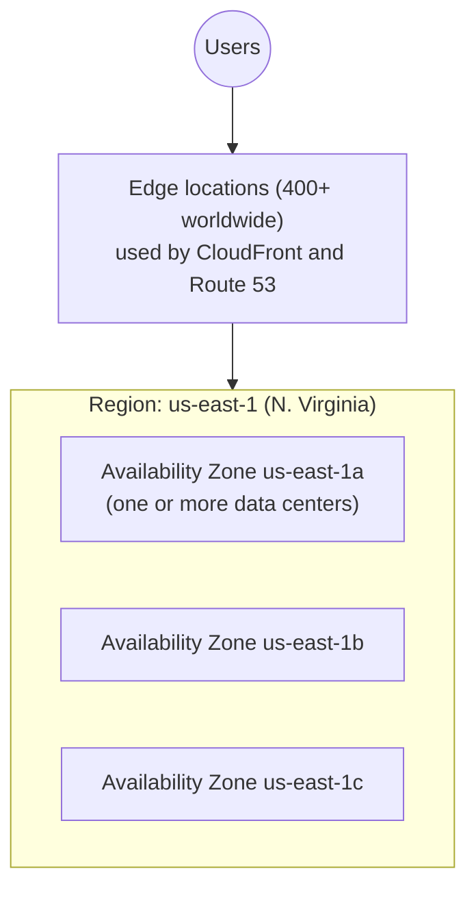
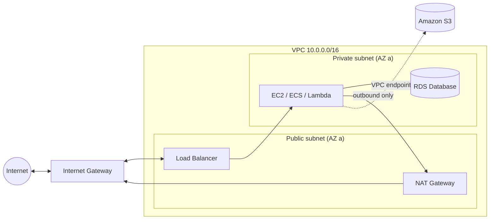
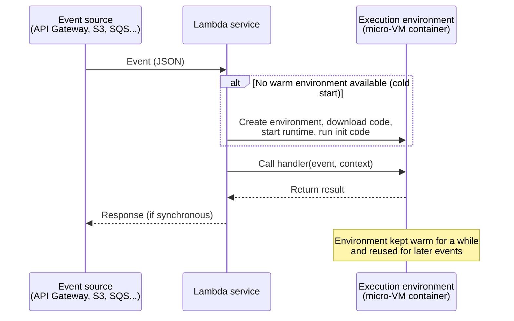
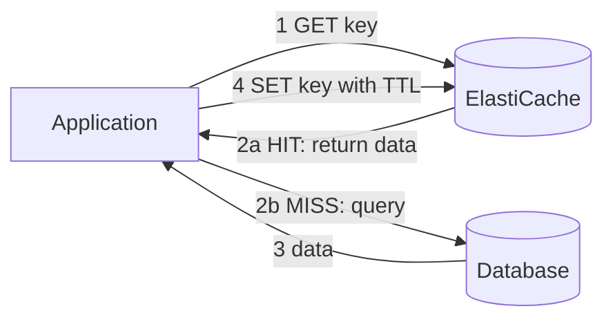

# Beginner Guide, Part 1: Cloud Basics, Networking, Compute, Storage, Databases

> **Start here if AWS is new to you.** This guide explains **what each service is, why it exists, and how it works**, using plain language and analogies. The exam-focused domain files (`01-` to `04-`) assume you already understand this material.
>
> Reading order: Part 1 (this file), then [Part 2](02-Integration-APIs-Security.md), then [Part 3](03-DevTools-Monitoring-Architecture.md).

Each service follows the same layout:
- **What it is:** a one-sentence definition
- **Analogy:** a real-world comparison
- **Problem it solves:** why you would use it
- **Key concepts:** vocabulary you must know
- **How it works:** the mechanics
- **Example:** what it looks like in practice
- **Exam focus:** the parts that get tested

---

## 1. Cloud computing fundamentals

### 1.1 What is "the cloud"?
**Cloud computing means renting computing resources (servers, storage, databases, networking, software) over the internet and paying only for what you use**, instead of buying and running your own hardware.

**Analogy:** You can generate your own electricity with a generator, which means buying it, fueling it, and repairing it. Or you can plug into the power grid and pay the monthly bill for what you consumed. AWS is the power grid for computing.

**Benefits:**
- **No upfront cost:** no need to buy servers.
- **Elasticity:** scale up when traffic grows and down when it shrinks, in minutes.
- **Speed:** a new server takes about a minute instead of weeks of procurement.
- **Global reach:** deploy close to users worldwide.
- **Managed services:** AWS handles patching, backups, and hardware failures.

### 1.2 Service models: who manages what

| Model | You manage | AWS manages | AWS examples |
|---|---|---|---|
| **IaaS** (Infrastructure as a Service) | OS, runtime, app, data | Hardware, network, virtualization | **EC2** (virtual servers) |
| **PaaS** (Platform as a Service) | App code and data | Everything below the app | **Elastic Beanstalk**, RDS |
| **Serverless / FaaS** | Just your function code | Everything else, including scaling | **Lambda**, DynamoDB, S3, SQS |
| **SaaS** (Software as a Service) | Only how you use it | Everything | Amazon WorkMail, Gmail (non-AWS) |

> **"Serverless"** doesn't mean there are no servers. It means **you never see or manage them**. You don't pick instance sizes, patch an OS, or pay for idle time. You pay per request or usage, and it scales automatically.

### 1.3 Shared responsibility model
- **AWS is responsible for security OF the cloud:** physical data centers, hardware, network, and the virtualization layer.
- **You are responsible for security IN the cloud:** your data, IAM permissions, encryption choices, network rules, and application code. On EC2 that also includes patching the OS.
- The more managed the service (for example, Lambda compared with EC2), the less you are responsible for.

### 1.4 AWS global infrastructure



- **Region:** a geographic area such as `us-east-1` (N. Virginia) or `eu-west-1` (Ireland). Regions are **completely independent**. Data does not leave a Region unless you move it. Most services are **regional**: a Lambda function in `us-east-1` does not exist in `eu-west-1`.
- **Availability Zone (AZ):** one or more physically separate data centers within a Region, with independent power and networking, connected by fast links. Each Region has 3 or more AZs. **Deploying across multiple AZs keeps your app running if one data center fails.** This is called **high availability**.
- **Edge location:** a small site in a major city that caches content close to users (CloudFront CDN) and answers DNS queries (Route 53).
- **Global services:** IAM, Route 53, CloudFront, and WAF for CloudFront are not tied to one Region.

**How to choose a Region:** proximity to users (latency), legal or data-residency requirements, service availability (not every service is in every Region), and price.

### 1.5 How you interact with AWS: everything is an API
Every action in AWS, such as creating a bucket or starting a server, is an **HTTPS API call**. You can make that call in three ways:

| Tool | What it is | Example |
|---|---|---|
| **AWS Management Console** | Website UI | Clicking "Create bucket" |
| **AWS CLI** | Command-line tool | `aws s3 mb s3://my-bucket` |
| **AWS SDKs** | Libraries for programming languages (Python `boto3`, JavaScript, Java, .NET, Go, and others) | `s3.create_bucket(Bucket="my-bucket")` |

All three call **the same API**. Each request is **signed** with your credentials using a process called **Signature Version 4 (SigV4)**, so AWS knows who is calling and can check permissions. The SDK and CLI sign requests for you.

**Credentials** come in two kinds:
- **Long-term:** an access key ID (`AKIA...`) plus a secret access key, belonging to an IAM user. These are risky if leaked.
- **Temporary:** access key, secret, and **session token**, issued by STS when you assume a role. They expire automatically. This is the recommended kind.

### 1.6 ARN (Amazon Resource Name)
Every resource has a globally unique ID called an ARN:
```
arn:aws:<service>:<region>:<account-id>:<resource>
arn:aws:lambda:us-east-1:123456789012:function:my-function
arn:aws:s3:::my-bucket/photos/cat.jpg        <- S3 has no region/account in ARN
arn:aws:iam::123456789012:role/MyLambdaRole   <- IAM is global, so no region
```
ARNs appear in IAM policies to say **which resources** a permission applies to.

### 1.7 Pricing basics
- **Pay-as-you-go:** per second (EC2), per request plus duration (Lambda), per GB stored (S3), per request or capacity (DynamoDB).
- **Data transfer:** data coming **into** AWS is free. Data going **out** to the internet costs money. Traffic between AZs costs a little.
- **Free Tier:** many services have free monthly allowances, such as 1M Lambda requests and 25 GB of DynamoDB storage. Check the current Free Tier terms when you sign up.
- **Always create an AWS Budget alert** before experimenting.

---

## 2. Networking basics (enough for a developer)

### 2.1 Amazon VPC (Virtual Private Cloud)
**What it is:** Your own **private, isolated network** inside AWS, where you launch resources such as EC2 servers, databases, and containers.

**Analogy:** AWS is a huge office park. A VPC is your own fenced building inside it. You decide which rooms (subnets) exist, which doors lead to the street (internet gateway), and who may enter each room (security groups).

**Key concepts:**
| Term | Meaning |
|---|---|
| **CIDR block** | The IP address range of the VPC, e.g., `10.0.0.0/16` (65,536 addresses) |
| **Subnet** | A slice of the VPC's IP range that lives in **one AZ** |
| **Public subnet** | Has a route to an **internet gateway**. Resources here can have public IPs and be reached from the internet (e.g., load balancers). |
| **Private subnet** | No direct internet route. Used for databases and app servers (more secure). |
| **Internet gateway (IGW)** | The VPC's door to the internet |
| **NAT gateway** | Lets resources in **private** subnets make **outbound** internet calls (e.g., download updates, call an external API) while staying unreachable from outside. Lives in a public subnet and costs per hour plus per GB. |
| **Route table** | Rules that say where network traffic goes |
| **Security group (SG)** | A **virtual firewall around a resource** (instance, Lambda ENI, RDS). **Allow rules only.** **Stateful**: if a request is allowed in, the response is automatically allowed out. |
| **Network ACL (NACL)** | Firewall at the **subnet** level. Allow **and** deny rules. **Stateless** (return traffic must be explicitly allowed). |
| **VPC endpoint** | Private connection from your VPC to AWS services (S3, DynamoDB, SQS, and others) **without going over the internet or through a NAT gateway**. Gateway endpoints (S3, DynamoDB) are free; interface endpoints (PrivateLink) cost a small fee. |



**Why developers care (common exam scenarios):**
- A Lambda function placed **inside a VPC** (to reach a private RDS database) **loses internet access** unless the subnet routes through a **NAT gateway**. It can reach S3 or DynamoDB through **VPC endpoints**.
- A database should sit in a **private subnet**, with its security group allowing traffic **only from the app's security group**.
- Every AWS account has a **default VPC** in each Region, with public subnets, so beginners can launch things immediately.

### 2.2 Elastic Load Balancing (ELB)
**What it is:** A managed service that **spreads incoming traffic across multiple targets** (EC2 instances, containers, Lambda functions, IP addresses) and stops sending traffic to unhealthy ones.

**Analogy:** A host at a busy restaurant seating guests evenly across waiters, and skipping a waiter who is out sick.

**Types:**
| Type | Layer | Use |
|---|---|---|
| **Application Load Balancer (ALB)** | Layer 7 (HTTP/HTTPS) | Web apps and microservices. Routes by **path** (`/api/*`), **host** (`api.example.com`), headers, or query strings. Supports Lambda targets, WebSockets, and Cognito authentication. |
| **Network Load Balancer (NLB)** | Layer 4 (TCP/UDP/TLS) | Extreme performance (millions of requests/sec), static IPs, non-HTTP protocols |
| Gateway Load Balancer | Layer 3 | Third-party network appliances (firewalls). Not a developer topic. |

**Key concepts:** **listener** (port and protocol, e.g., HTTPS:443), **target group** (the set of backends), **health checks** (e.g., `GET /health` must return 200), and **SSL/TLS termination** (the load balancer handles HTTPS using a certificate from ACM).

### 2.3 Amazon Route 53
**What it is:** AWS's **DNS** service. DNS translates names like `www.example.com` into IP addresses.

**Analogy:** The internet's phone book.

**Key concepts:**
- **Hosted zone:** the container for your domain's records.
- **Record types:** `A` (name to IPv4 address), `AAAA` (IPv6), `CNAME` (name to another name; not allowed at the zone apex such as `example.com`), and **Alias** (an AWS-specific record that points to AWS resources such as an ALB, CloudFront, or S3 website; works at the apex and is free).
- **Routing policies:** simple, **weighted** (e.g., 90/10 split for testing a new version), **latency-based** (send users to the closest Region), **failover** (send traffic to a backup when the health check fails), geolocation, multivalue.
- **Health checks** monitor endpoints.

### 2.4 Amazon CloudFront
**What it is:** AWS's **Content Delivery Network (CDN)**. It caches copies of your content (images, JS, videos, API responses) at **edge locations** around the world, so users download from a nearby location.

**Analogy:** Instead of every customer driving to the central warehouse, you stock local convenience stores.

**Key concepts:**
- **Distribution:** your CloudFront configuration, with a domain like `d123.cloudfront.net`.
- **Origin:** where the original content lives (S3 bucket, ALB, EC2, API Gateway, any HTTP server).
- **Cache behavior and TTL:** which paths are cached and for how long.
- **Invalidation:** force removal of cached files before their TTL expires (it costs money, so prefer versioned file names like `app.v2.js`).
- **Origin Access Control (OAC):** keeps an S3 bucket **private** while CloudFront can still read it.
- **Signed URLs / signed cookies:** restrict content to paying or logged-in users.
- **Edge compute:** **CloudFront Functions** (tiny, very fast JavaScript) and **Lambda@Edge** (more powerful) let you modify requests and responses at the edge.

---

## 3. Compute services (where your code runs)

### 3.1 Amazon EC2 (Elastic Compute Cloud)
**What it is:** **Virtual servers (called instances) that you rent** by the second. You choose the OS, CPU and memory size, and you have full control (SSH or RDP).

**Analogy:** Renting an apartment. You get the empty space with utilities, and you install the furniture, clean, and maintain it.

**Problem it solves:** You need a server without buying hardware, and you want full control of the OS and software.

**Key concepts:**
| Term | Meaning |
|---|---|
| **AMI (Amazon Machine Image)** | A template/snapshot of the OS and software used to launch instances (e.g., Amazon Linux 2023, Ubuntu, Windows, or your own custom AMI) |
| **Instance type** | Hardware size. In `t3.micro`: `t` = family (burstable general purpose), `3` = generation, `micro` = size. Families: `m` general, `c` compute-optimized, `r` memory-optimized, `g`/`p` GPU. A `g` suffix (e.g., `m7g`) = Graviton ARM processor. |
| **EBS volume** | The instance's virtual hard disk (see Storage) |
| **Key pair** | SSH key to log in |
| **Security group** | Firewall: e.g., allow port 22 (SSH) from your IP, port 443 from anywhere |
| **User data** | A script that runs **once, at first boot**, e.g., to install a web server |
| **Instance metadata (IMDS)** | An internal URL `http://169.254.169.254/latest/meta-data/` that lets code on the instance learn about itself (instance ID, Region, **temporary role credentials**). **IMDSv2** requires a session token and is more secure. |
| **Instance profile / IAM role** | Gives the instance AWS permissions **without storing access keys** on it (see IAM in Part 2) |
| **Elastic IP** | A fixed public IP address |

**Pricing options:**
- **On-Demand:** pay per second, no commitment.
- **Savings Plans / Reserved Instances:** commit for 1 or 3 years for up to about 72% off.
- **Spot Instances:** use spare capacity for up to 90% off, but AWS can reclaim them with 2 minutes' notice. Good for fault-tolerant batch jobs.

**Instance states:** pending → running → stopping → stopped (no compute charge, but EBS storage is still billed) → terminated (deleted).

**Monitoring note:** By default CloudWatch sees CPU, network, and disk I/O, but **not memory usage**, because that lives inside the OS. You need the **CloudWatch agent** for memory.

### 3.2 EC2 Auto Scaling
**What it is:** Automatically adds or removes EC2 instances based on demand, and **replaces unhealthy instances**.

**Key concepts:**
- **Auto Scaling group (ASG):** a group of identical instances with **minimum**, **desired**, and **maximum** counts.
- **Launch template:** what to launch (AMI, type, security group, user data).
- **Scaling policies:**
  - **Target tracking**, e.g., "keep average CPU at 50%". This is the simplest option.
  - **Step scaling**: scale by different amounts depending on how far a metric is past the threshold.
  - **Scheduled**: e.g., scale up at 8 AM.
  - **Predictive**: forecast-based.
- Usually placed **behind a load balancer** and spread **across AZs**.

### 3.3 AWS Lambda (the most important service for this exam)
**What it is:** A **serverless compute service that runs your code (a "function") in response to events**. You upload code, and AWS runs it only when triggered, scales it automatically from zero to thousands of parallel copies, and bills you **only for the milliseconds it runs**.

**Analogy:** A taxi rather than owning a car. You don't pay for parking, insurance, or maintenance; you pay only for each trip. When 1,000 people need rides at once, 1,000 taxis appear.

**Problem it solves:** Running small pieces of backend logic without managing servers or paying for idle time.

**How it works:**


1. Something triggers the function: an HTTP request via API Gateway, a file uploaded to S3, a message in SQS, a schedule, and so on.
2. Lambda finds an idle **execution environment** (a lightweight, isolated micro-VM). If none exists, it creates one. That is a **cold start**, which adds latency (from about 100 ms to a few seconds).
3. Lambda calls your **handler** function with the **event** (a JSON document describing what happened) and a **context** object (request ID, remaining time, and so on).
4. Your code runs and returns a result.
5. The environment stays **warm** for a while and is reused for the next event, which avoids another cold start. Anything you created **outside** the handler, such as DB connections and SDK clients, is reused.

**Example (Python):**
```python
import json, boto3, os

dynamodb = boto3.resource("dynamodb")             # runs ONCE per environment (cold start) -> reused
table = dynamodb.Table(os.environ["TABLE_NAME"])  # config from environment variable

def lambda_handler(event, context):              # runs on EVERY invocation
    order = json.loads(event["body"])             # event from API Gateway
    table.put_item(Item={"orderId": order["id"], "amount": order["amount"]})
    return {"statusCode": 201, "body": json.dumps({"ok": True})}
```

**Example (Node.js):**
```javascript
export const handler = async (event, context) => {
  console.log("Request ID:", context.awsRequestId); // goes to CloudWatch Logs
  return { statusCode: 200, body: JSON.stringify({ hello: "world" }) };
};
```

**Key concepts:**
| Term | Meaning |
|---|---|
| **Function** | Your code plus configuration (runtime, memory, timeout, env vars, role) |
| **Runtime** | Language environment: Python, Node.js, Java, .NET, Ruby, or a custom runtime / container image |
| **Handler** | The entry-point function name, e.g., `app.lambda_handler` (file `app.py`, function `lambda_handler`) |
| **Trigger / event source** | What invokes the function |
| **Memory** | 128 MB – 10 GB. **CPU power scales with memory**, so more memory also means more CPU. |
| **Timeout** | Max runtime per invocation, **up to 15 minutes** |
| **Execution role** | IAM role that defines what AWS services **the function can call** |
| **Environment variables** | Configuration values (e.g., table name) read by your code |
| **Layer** | A shared zip of libraries or dependencies reused across functions |
| **Version** | An immutable, numbered snapshot of the code and config (1, 2, 3...) |
| **Alias** | A named pointer to a version (e.g., `prod` → version 3) that can split traffic between two versions |
| **Concurrency** | How many copies run at the same time. Default limit is 1,000 per Region per account. |
| **Cold start** | Extra latency when a new environment is created |

**Pricing:** number of requests plus **GB-seconds** (memory × duration).

**Logs:** anything you print (`print`, `console.log`) goes automatically to **CloudWatch Logs**.

**Limitations:** max 15 minutes, stateless (local disk `/tmp` is temporary), payload limits. It isn't suitable for long-running servers.

### 3.4 Containers: Docker, ECR, ECS, Fargate, EKS

**First, what is a container?**
A **container** packages your application **with everything it needs** (runtime, libraries, config) into one portable unit that runs the same way on any machine. A **Docker image** is the packaged template (built from a `Dockerfile`), and a **container** is a running instance of that image. Images are stored in a **registry**.

**Analogy:** A shipping container. Whatever is inside, ports and ships handle it the same way.

#### Amazon ECR (Elastic Container Registry)
**What it is:** AWS's private **storage for Docker images** (like Docker Hub, but private and integrated with IAM). You `docker push` images to ECR, and ECS, EKS, or Lambda pull them from it.

#### Amazon ECS (Elastic Container Service)
**What it is:** AWS's **container orchestrator**. It decides where containers run, restarts them if they crash, connects them to load balancers, and scales them.

| Term | Meaning |
|---|---|
| **Cluster** | Logical group where tasks run |
| **Task definition** | A JSON "recipe": which image(s), CPU/memory, ports, env vars, IAM roles, logging |
| **Task** | A running instance of a task definition (one or more containers) |
| **Service** | Keeps **N tasks** running at all times, replaces failed ones, attaches them to a load balancer, and auto scales |
| **Launch type: EC2** | Tasks run on EC2 instances that **you** manage |
| **Launch type: Fargate** | **Serverless containers**: no EC2 instances to manage; you just specify CPU and memory per task |
| **Task role** | Permissions for **your app code** inside the container (e.g., read S3) |
| **Task execution role** | Permissions for **ECS itself** to pull the image from ECR, write logs, and read secrets |

#### AWS Fargate
The **serverless engine** for containers (used by ECS or EKS). You don't patch or size servers.

#### Amazon EKS (Elastic Kubernetes Service)
Managed **Kubernetes**, the popular open-source orchestrator. Choose it when your team already uses Kubernetes. It is only lightly tested on this exam.

#### AWS App Runner
The **simplest** way to run a containerized web app or API. Give it source code or an image, and it builds, deploys, load balances, scales, and provides HTTPS, with no other configuration.

### 3.5 AWS Elastic Beanstalk
**What it is:** A **Platform as a Service**. You **upload your application code** (Java, .NET, Node.js, Python, PHP, Ruby, Go, Docker), and Beanstalk **automatically creates and manages** the EC2 instances, load balancer, Auto Scaling group, monitoring, and deployments.

**Analogy:** A furnished, serviced apartment. You bring your suitcase (code), and everything else is set up and maintained.

**Key concepts:**
- **Application:** a container for versions and environments.
- **Application version:** a specific uploaded code bundle (zip).
- **Environment:** a running copy of a version (e.g., `myapp-prod`), with its own URL.
- **Web server tier** (handles HTTP) vs **worker tier** (processes background jobs from an SQS queue).
- **Deployment policies:** how a new version is rolled out (all at once, rolling, immutable, and so on).
- **`.ebextensions`:** config files in your code that customize the environment.

You still have full access to the underlying EC2 instances if needed. Beanstalk itself is free; you pay for the EC2 instances, load balancer, and other resources it creates. Under the hood it uses **CloudFormation**.

### 3.6 Which compute service should I choose?

| Need | Choose |
|---|---|
| Full control of the OS, legacy software, long-running server | **EC2** |
| Upload a web app and let AWS handle the infrastructure | **Elastic Beanstalk** |
| Event-driven, short tasks (< 15 min), pay per use, no servers | **Lambda** |
| Containerized microservices without managing servers | **ECS on Fargate** |
| Already using Kubernetes | **EKS** |
| Simplest container web app | **App Runner** |
| Long batch jobs | **AWS Batch**, ECS/Fargate, or EC2 Spot |

---

## 4. Storage services

### 4.0 Three kinds of storage

| Type | What it is | Analogy | AWS service |
|---|---|---|---|
| **Object** | Whole files with metadata, accessed by key over HTTP; you replace whole objects rather than editing them | Coat check: hand in a coat, get a ticket (key) | **S3** |
| **Block** | Raw disk attached to one server; the OS formats it | A hard drive plugged into your PC | **EBS** |
| **File** | Shared folder that many servers mount at once | Network shared drive | **EFS** (Linux), FSx (Windows and others) |

### 4.1 Amazon S3 (Simple Storage Service)
**What it is:** **Object storage with virtually unlimited capacity.** Store any file (images, videos, backups, logs, static websites, data lakes) and retrieve it via an API or URL. It is designed for 99.999999999% (11 nines) **durability**.

**Analogy:** An infinite, extremely reliable file locker. Each file has a unique address (bucket + key).

**Key concepts:**
| Term | Meaning |
|---|---|
| **Bucket** | A container for objects. **The name must be globally unique** across all AWS accounts. Created in one Region. |
| **Object** | A file plus metadata. Max 5 TB. |
| **Key** | The object's full name/path, e.g., `photos/2024/cat.jpg` |
| **Prefix** | The "folder" part of a key (`photos/2024/`). **S3 has no real folders**; the console just displays prefixes as folders. |
| **Versioning** | Keeps every version of an object, protecting against accidental overwrite or delete |
| **Storage classes** | Price tiers based on access frequency (below) |
| **Lifecycle rules** | Automatically move objects to cheaper classes or delete them after N days |
| **Bucket policy** | JSON permissions on the bucket (e.g., allow another account, deny non-HTTPS) |
| **Block Public Access** | On by default. Prevents accidental public exposure. |
| **Presigned URL** | A temporary link that lets someone without AWS credentials download or upload a specific object |
| **Event notifications** | Trigger Lambda, SQS, SNS, or EventBridge when objects are created or deleted |
| **Static website hosting** | Serve HTML/CSS/JS directly from a bucket |

**Storage classes (cheaper storage costs more to retrieve):**
| Class | Use case |
|---|---|
| **S3 Standard** | Frequently accessed data (default) |
| **S3 Intelligent-Tiering** | Unknown or changing access patterns; AWS moves objects automatically |
| **S3 Standard-IA** (Infrequent Access) | Accessed rarely but needed quickly (backups) |
| **S3 One Zone-IA** | Like Standard-IA but stored in one AZ (cheaper, less resilient) |
| **S3 Glacier Instant Retrieval** | Archive that is accessed occasionally, retrieved in milliseconds |
| **S3 Glacier Flexible Retrieval** | Archive retrieved in minutes to hours |
| **S3 Glacier Deep Archive** | Cheapest; retrieval takes 12–48 hours (compliance records) |

**Example (CLI and Python):**
```bash
aws s3 mb s3://my-unique-bucket-12345              # make bucket
aws s3 cp cat.jpg s3://my-unique-bucket-12345/photos/cat.jpg
aws s3 ls s3://my-unique-bucket-12345/photos/
aws s3 presign s3://my-unique-bucket-12345/photos/cat.jpg --expires-in 300
```
```python
import boto3
s3 = boto3.client("s3")
s3.upload_file("cat.jpg", "my-unique-bucket-12345", "photos/cat.jpg")
url = s3.generate_presigned_url("get_object",
        Params={"Bucket": "my-unique-bucket-12345", "Key": "photos/cat.jpg"}, ExpiresIn=300)
```

**Security defaults:** new buckets are **private**, **encrypted by default** (SSE-S3), and have **Block Public Access** turned on.

### 4.2 Amazon EBS (Elastic Block Store)
**What it is:** A **virtual hard disk** for EC2 instances.
- Attached to **one instance at a time** (except io1/io2 Multi-Attach) and lives in **one AZ**.
- It **persists independently** of the instance (unless "delete on termination" is set, which is the default for root volumes).
- **Snapshots** are point-in-time backups stored in S3 behind the scenes. They can be copied across Regions.
- Types: **gp3/gp2** (general SSD), **io2/io1** (high-performance SSD for databases), **st1/sc1** (HDD for throughput or cold data).
- **Instance store:** a disk physically attached to the host. Very fast but **lost when the instance stops**.

### 4.3 Amazon EFS (Elastic File System)
**What it is:** A managed **shared network file system (NFS)** for Linux that **many EC2 instances, containers, or Lambda functions can mount at the same time**, across AZs. It grows and shrinks automatically.
Use case: shared uploads folder for a fleet of web servers, or shared content for containers.

---

## 5. Database services

### 5.0 Relational (SQL) vs NoSQL

| | Relational (SQL) | NoSQL (e.g., DynamoDB) |
|---|---|---|
| Structure | Tables with a **fixed schema**, rows and columns, relationships through **JOINs** | Flexible schema; each item can have different attributes |
| Query | SQL (`SELECT ... JOIN ... WHERE`), so very flexible | Access by **key**; you design the table around your queries |
| Scaling | Mostly **vertical** (bigger server) plus read replicas | **Horizontal** (spread across many partitions), so effectively unlimited |
| Best for | Complex queries, transactions, reporting | Massive scale, predictable low latency, simple access patterns |
| AWS | **RDS, Aurora** | **DynamoDB** |

### 5.1 Amazon RDS (Relational Database Service)
**What it is:** A **managed relational database**. You choose an engine (**MySQL, PostgreSQL, MariaDB, Oracle, SQL Server, Db2**), and AWS handles provisioning, OS and DB patching, backups, and failover.

**Analogy:** A database with a full-time DBA included. You still design the tables and write the SQL.

**Key concepts:**
- **DB instance:** the database server (you pick its size).
- **Automated backups** with **point-in-time restore**, plus manual **snapshots**.
- **Multi-AZ:** a **standby copy in another AZ**, kept in sync. If the primary fails, RDS **automatically fails over**. This is for **high availability, not performance**; you can't read from the classic standby.
- **Read replicas:** **asynchronous copies** used to **scale reads** (reports, analytics). Your app must send reads to the replica's endpoint.
- **RDS Proxy:** a connection pool in front of RDS. It is important for **Lambda**, because thousands of parallel functions would otherwise open thousands of DB connections and overwhelm the database.
- **IAM database authentication:** log in with a short-lived token instead of a password (MySQL/PostgreSQL).

**Amazon Aurora:** AWS's high-performance, cloud-native MySQL- and PostgreSQL-compatible engine. It keeps 6 copies of data across 3 AZs, supports up to 15 low-latency read replicas, and has a **writer endpoint** and a **reader endpoint**. **Aurora Serverless v2** scales capacity automatically.

### 5.2 Amazon DynamoDB (very important for the exam)
**What it is:** A **fully managed, serverless NoSQL key-value and document database** that delivers **single-digit millisecond** performance at **any scale**. There are no servers, no patching, and no connection limits, and it is accessed over HTTPS API calls.

**Analogy:** A giant, infinitely expandable filing cabinet. Each drawer is a **partition**, chosen by the **partition key**. Inside a drawer, folders are sorted by the **sort key**. If you know the drawer and folder, you find a document instantly. If you don't, you must open every drawer (a **Scan**), which is slow and expensive.

**Key concepts with an example.** Here is a table `Orders`:

| customerId (partition key) | orderDate (sort key) | total | status | items |
|---|---|---|---|---|
| C001 | 2024-01-05 | 59.90 | SHIPPED | [...] |
| C001 | 2024-03-12 | 15.00 | PENDING | [...] |
| C002 | 2024-02-01 | 120.00 | SHIPPED | [...] |

| Term | Meaning |
|---|---|
| **Table** | A collection of items (no fixed schema except the key) |
| **Item** | One record (like a row). **Max 400 KB.** |
| **Attribute** | A field (like a column). Types: String, Number, Binary, Boolean, Null, List, Map, Set. |
| **Partition key (PK)** | Required. DynamoDB **hashes** it to decide which physical partition stores the item. It should have **many distinct values** (e.g., customerId) so load spreads evenly. |
| **Sort key (SK)** | Optional. Orders items that share a partition key and enables range queries (`orderDate BETWEEN '2024-01-01' AND '2024-02-28'`). |
| **Primary key** | PK alone, or PK + SK. Must be **unique** per item. |

**How data is read:**
- **GetItem:** fetch one item by its full primary key. Fastest.
- **Query:** fetch all items with a given **partition key**, optionally filtered by sort key ("all orders for C001 in 2024"). Efficient.
- **Scan:** read **every item in the table** and then filter. Slow and costly on big tables, so avoid it in production paths.

**Secondary indexes (query by other attributes):**
Suppose you want "all orders with status = PENDING". `status` isn't the key, so you add an index:
- **GSI (Global Secondary Index):** a copy of the data organized by **a different partition key** (e.g., `status`). It can be added any time.
- **LSI (Local Secondary Index):** **same partition key**, different sort key (e.g., `customerId` + `total`). It **must be created when the table is created**.

**Capacity (how you pay for throughput):**
- **On-demand mode:** pay per request, with no planning. Best when traffic is unpredictable.
- **Provisioned mode:** you declare how many reads and writes per second you need:
  - **RCU (Read Capacity Unit)** = 1 strongly consistent read per second of up to 4 KB (or 2 eventually consistent reads).
  - **WCU (Write Capacity Unit)** = 1 write per second of up to 1 KB.
  - Going over the limit gets requests **throttled** (`ProvisionedThroughputExceededException`); the SDK retries automatically.

**Consistency:**
- **Eventually consistent read** (default, cheaper): might return data that is a fraction of a second old.
- **Strongly consistent read**: always returns the latest data and costs twice as much.

**Other features (overview):**
- **DynamoDB Streams:** a change log of every insert, update, or delete. It can **trigger Lambda** (e.g., send a welcome email when a user is created).
- **TTL (Time to Live):** auto-delete items after a timestamp, for free (e.g., expire sessions).
- **DAX (DynamoDB Accelerator):** an in-memory cache in front of DynamoDB that brings reads from milliseconds to **microseconds**.
- **Transactions:** all-or-nothing writes across multiple items.
- **Global Tables:** replicate a table across Regions.
- **Backups:** on-demand backups and point-in-time recovery.

**Example (Python boto3):**
```python
import boto3
from boto3.dynamodb.conditions import Key

table = boto3.resource("dynamodb").Table("Orders")

table.put_item(Item={"customerId": "C001", "orderDate": "2024-03-12", "total": 15, "status": "PENDING"})

item = table.get_item(Key={"customerId": "C001", "orderDate": "2024-03-12"})["Item"]

orders_2024 = table.query(
    KeyConditionExpression=Key("customerId").eq("C001") & Key("orderDate").begins_with("2024")
)["Items"]
```

### 5.3 Amazon ElastiCache
**What it is:** A managed **in-memory data store** (**Redis OSS / Valkey** or **Memcached**) used as a **cache**. Reading from RAM takes microseconds to under a millisecond, compared with milliseconds from a database.

**Analogy:** Keeping the files you use every day on your desk instead of walking to the archive room each time.

**Why cache?** It reduces load on the database, speeds up responses, and can store **user sessions** so any web server can handle any user.

**The most common pattern, lazy loading (cache-aside):**

- **Write-through:** update the cache every time you write to the DB, so the cache is always fresh.
- **TTL (time to live):** cached entries expire automatically, which limits stale data.

**Redis/Valkey vs Memcached:** Redis/Valkey has replication, high availability, persistence, and rich data types (sorted sets for leaderboards, pub/sub). Memcached is simpler: multithreaded with no persistence. **The exam usually prefers Redis** when HA or advanced features are needed.

> **Note:** Using ElastiCache requires **code changes**: your app must explicitly read from and write to the cache. DAX is different: it's a drop-in replacement client for DynamoDB.

### 5.4 Which database should I choose?

| Need | Choose |
|---|---|
| Relational data, SQL, joins, existing MySQL/Postgres app | **RDS** or **Aurora** |
| Serverless, massive scale, key-value access, millisecond latency | **DynamoDB** |
| Microsecond reads for DynamoDB | **DAX** |
| Cache for any DB, sessions, leaderboards | **ElastiCache** |
| Full-text search | **OpenSearch Service** |
| Data warehouse / analytics | **Redshift** (not on this exam) |

---

**Next:** [Part 2: Integration, APIs, and Security](02-Integration-APIs-Security.md)
