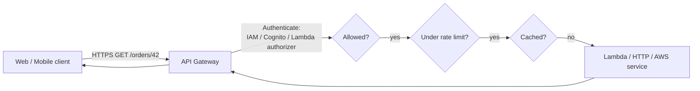
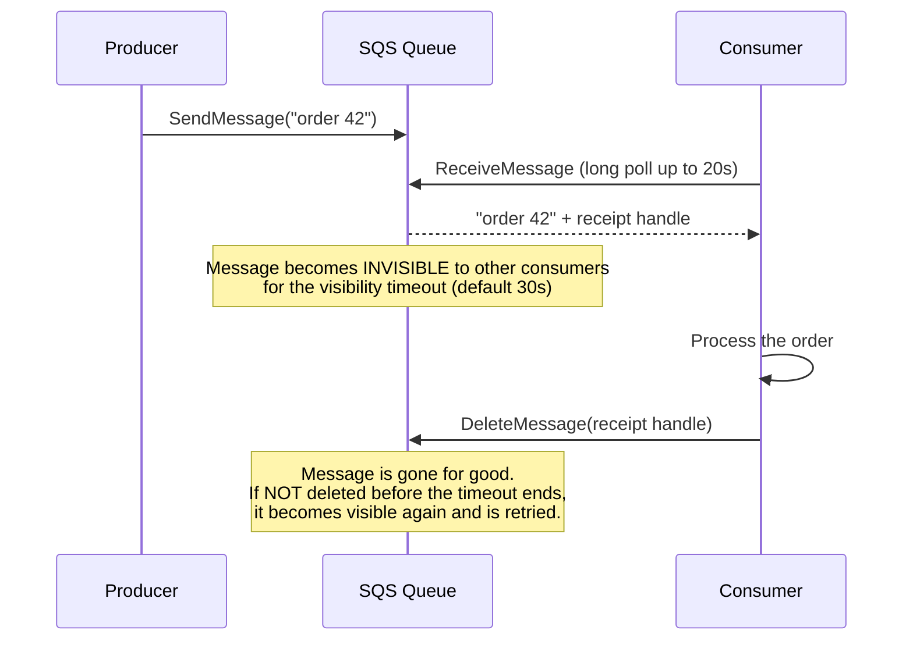
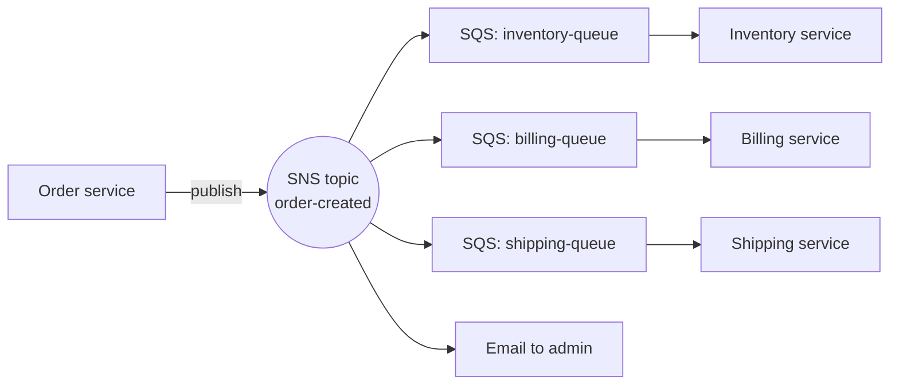
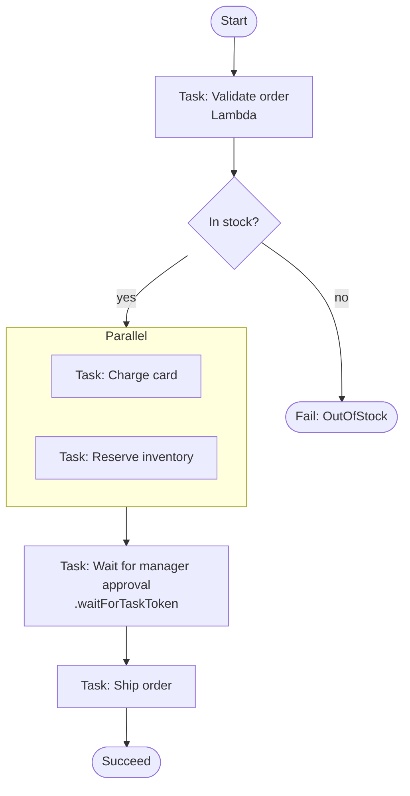
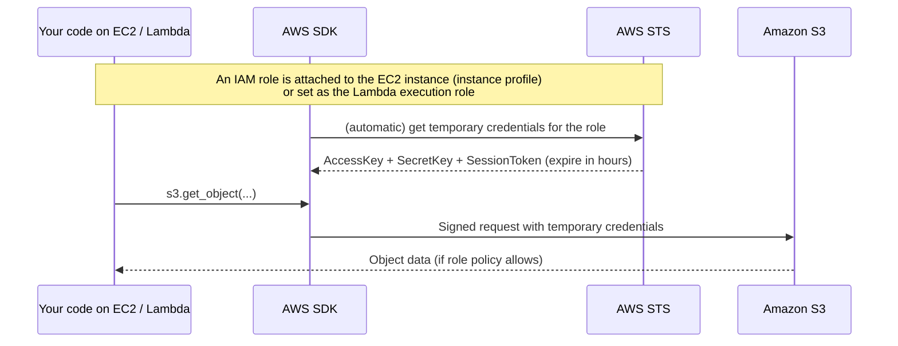
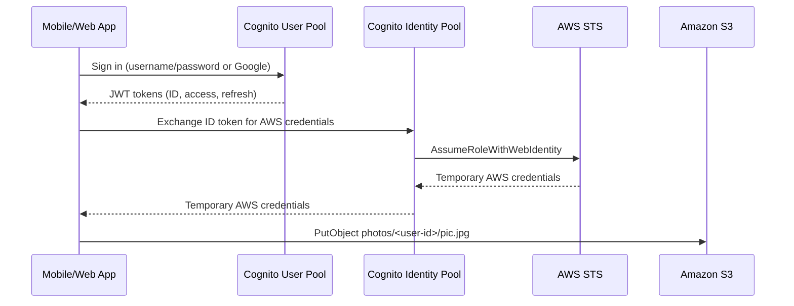
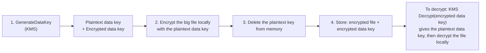

# Beginner Guide, Part 2: Application Integration, APIs, and Security

> Previous: [Part 1](01-Cloud-Basics-Networking-Compute-Storage-Databases.md) · Next: [Part 3](03-DevTools-Monitoring-Architecture.md)

---

## 1. Why application integration matters

Modern apps are built from many small components (microservices, functions) that must talk to each other. There are two ways to do that:

| | **Synchronous** (tight coupling) | **Asynchronous** (loose coupling) |
|---|---|---|
| How | A calls B directly and **waits** for the answer | A drops a message somewhere and **moves on**; B processes it later |
| Analogy | A **phone call**: both people must be available at the same time | A **mailbox** or **voicemail**: the receiver handles it when ready |
| Problem | If B is slow or down, A is slow or down too. Traffic spikes hit B directly. | Slight delay, and you must handle duplicates and retries |
| AWS | API Gateway → Lambda, ALB → EC2 | **SQS, SNS, EventBridge, Kinesis** |

**Loose coupling** makes systems more **resilient** (one part failing doesn't break the others) and more **scalable** (a queue absorbs traffic spikes). The exam strongly favors decoupled designs.

---

## 2. Amazon API Gateway

**What it is:** A fully managed service to **create, publish, secure, and monitor APIs** (REST, HTTP, and WebSocket). It is the **front door** that receives HTTP requests from clients (web, mobile, partners) and forwards them to your backend (Lambda, HTTP servers, or AWS services directly).

**Analogy:** A hotel reception desk. Guests (clients) don't walk into the kitchen. They ask reception, which checks their room key (authentication), limits how many requests each guest can make (throttling), and routes each request to the right department (backend).

**Problem it solves:** Without it, you'd need to run and scale web servers just to receive requests, check authentication, enforce rate limits, and so on.



**Key concepts:**
| Term | Meaning |
|---|---|
| **API types** | **REST API** (most features), **HTTP API** (simpler, cheaper, faster), **WebSocket API** (real-time two-way: chat, live dashboards) |
| **Resource** | A URL path, e.g., `/orders` or `/orders/{id}` |
| **Method** | HTTP verb on a resource: GET, POST, PUT, DELETE |
| **Integration** | What the method calls: Lambda, an HTTP endpoint, an AWS service (e.g., SQS), or a MOCK |
| **Proxy integration** | Passes the whole request to the backend unchanged; the backend builds the full response. The simplest and most common option with Lambda. |
| **Mapping template** | Transforms the request or response (non-proxy integration), using the VTL template language |
| **Stage** | A named deployment of the API (`dev`, `prod`) with its own URL: `https://abc123.execute-api.us-east-1.amazonaws.com/prod/orders` |
| **Deployment** | A snapshot of the API configuration. **Changes go live only after you deploy to a stage.** |
| **Stage variables** | Per-stage settings, e.g., point `dev` at Lambda alias `dev` and `prod` at alias `prod` |
| **Authorizers** | How callers are authenticated: **IAM**, **Cognito user pool**, or a **Lambda authorizer** (custom logic) |
| **Throttling** | Rate limits; excess requests get **HTTP 429** |
| **Usage plans + API keys** | Per-customer rate limits and quotas (e.g., free tier = 1,000 requests/day) |
| **Caching** | Store responses for a TTL to reduce backend calls (REST APIs) |
| **CORS** | Browser rule that must be enabled when a web page on another domain calls your API |

**Lambda proxy response format.** Your Lambda must return this shape, or clients get a **502 error**:
```json
{ "statusCode": 200, "headers": {"Content-Type": "application/json"}, "body": "{\"id\": 42}" }
```

**Important limit:** API Gateway waits up to **29 seconds** for the backend by default. Longer work should be made asynchronous.

---

## 3. Amazon SQS (Simple Queue Service)

**What it is:** A fully managed **message queue**. Producers put messages into the queue; consumers pull them out and process them at their own pace. The queue stores messages durably until they're processed (up to 14 days).

**Analogy:** The **order ticket rail in a restaurant kitchen**. Waiters (producers) clip order tickets on the rail as customers order. Cooks (consumers) take tickets one by one. If 100 orders arrive at once, the tickets wait on the rail; nothing is lost and the cooks aren't overwhelmed. Add more cooks to go faster.

**Problem it solves:** Decoupling and buffering. The producer doesn't care whether the consumer is busy or down, and traffic spikes are smoothed out.

**Message lifecycle (very important):**


**Key concepts:**
| Term | Meaning |
|---|---|
| **Standard queue** | Practically unlimited throughput; **at-least-once** delivery (rare duplicates possible); **best-effort ordering** |
| **FIFO queue** | **First-In-First-Out**: strict ordering and **exactly-once processing**. Lower throughput. The name must end in `.fifo`. |
| **Visibility timeout** | How long a received message stays hidden while a consumer works on it |
| **Long polling** | The consumer waits up to 20 s for messages to arrive, which means fewer empty responses and lower cost. Recommended. |
| **Dead-letter queue (DLQ)** | A separate queue where messages go after failing N times (`maxReceiveCount`), so you can inspect "poison" messages |
| **Delay queue** | Messages become visible only after a delay (up to 15 min) |
| **Retention** | How long unprocessed messages are kept (default 4 days, max 14) |
| **Message size** | Up to 256 KB classically (raised to 1 MiB in 2025). Larger payloads go in S3 with a pointer in the message. |

**Example (Python):**
```python
import boto3
sqs = boto3.client("sqs")
url = sqs.get_queue_url(QueueName="orders")["QueueUrl"]

sqs.send_message(QueueUrl=url, MessageBody='{"orderId": 42}')                   # producer

resp = sqs.receive_message(QueueUrl=url, WaitTimeSeconds=20, MaxNumberOfMessages=10)  # consumer
for msg in resp.get("Messages", []):
    print(msg["Body"])
    sqs.delete_message(QueueUrl=url, ReceiptHandle=msg["ReceiptHandle"])        # must delete!
```

**With Lambda:** you can set SQS as a Lambda trigger. Lambda polls the queue for you, invokes your function with a **batch** of messages, and deletes them if the function succeeds.

---

## 4. Amazon SNS (Simple Notification Service)

**What it is:** A fully managed **publish/subscribe (pub/sub) messaging service**. A publisher sends a message to a **topic**, and SNS **immediately pushes a copy to every subscriber** of that topic.

**Analogy:** A **newsletter or a radio broadcast**. The publisher writes once, and everyone subscribed gets a copy at the same time.

**Problem it solves:** One event needs to reach many different systems or people.

**Key concepts:**
| Term | Meaning |
|---|---|
| **Topic** | A named channel (e.g., `order-created`) |
| **Publisher** | Sends messages to the topic |
| **Subscription** | An endpoint that receives messages: **SQS queue, Lambda, HTTP/HTTPS, email, SMS, mobile push, Firehose** |
| **Filter policy** | A subscriber receives only messages matching criteria (e.g., `{"country": ["US"]}`) |
| **FIFO topic** | Ordered and deduplicated, delivered to SQS FIFO queues |

**SNS doesn't store messages.** If a subscriber is down, delivery is retried for a while, but SNS is not a queue. That's why **SNS + SQS fan-out** is the classic pattern:


Each service gets **its own durable copy**, so if billing is down, its messages wait safely in its queue.

---

## 5. Amazon EventBridge

**What it is:** A serverless **event bus** that receives **events** (JSON describing "something happened") from AWS services, your own apps, and SaaS partners (Zendesk, Datadog, Shopify), and **routes them to targets using rules**.

**Analogy:** A **post office sorting center**. Letters (events) arrive from everywhere, and sorting rules ("all letters from AWS EC2 about stopped instances go to the ops team") send each one to the right destination.

**Problem it solves:** Building **event-driven architectures** where services react to events without knowing about each other. It also replaces cron servers through **schedules**.

**Example event** (an EC2 instance stopped):
```json
{
  "source": "aws.ec2",
  "detail-type": "EC2 Instance State-change Notification",
  "detail": { "instance-id": "i-0abc123", "state": "stopped" }
}
```
**Example rule pattern** (match only stopped instances):
```json
{ "source": ["aws.ec2"], "detail": { "state": ["stopped"] } }
```
The target could be a Lambda function that restarts the instance or an SNS topic that alerts the team.

**Key concepts:**
| Term | Meaning |
|---|---|
| **Event bus** | Receives events: the **default bus** (AWS service events), **custom buses** (your apps), **partner buses** (SaaS) |
| **Rule** | Matches events by **pattern** (or runs on a **schedule**) and sends them to up to 5 **targets** |
| **Target** | Lambda, SQS, SNS, Step Functions, Kinesis, ECS task, API destination (any HTTP API), another bus, and more |
| **Archive and replay** | Store events and re-send them later (e.g., after fixing a bug) |
| **Schema registry** | Discovers event structures and generates code classes |
| **EventBridge Scheduler** | Run something on a cron or rate schedule, or once at a specific time |
| **Pipes** | Connect a source (e.g., SQS) to a target with optional filtering and enrichment, without writing code |

**SNS vs EventBridge:** SNS has **very high throughput and simple fan-out** to subscribers. EventBridge has **rich content-based routing**, many target types, AWS and SaaS sources, and archive and replay.

---

## 6. Amazon Kinesis (streaming data)

### 6.1 Kinesis Data Streams
**What it is:** A service for collecting and processing **large streams of data records in real time** (clickstreams, IoT sensor readings, application logs, financial transactions). Data is **stored for 24 hours up to 365 days** and can be **read by multiple consumers and replayed**.

**Analogy:** A **conveyor belt with a video recording**. Items move along the belt in order. Several workers can watch the same belt, and you can rewind the recording to look at items again. SQS is different: once a cook takes a ticket, it's gone.

**Key concepts:**
| Term | Meaning |
|---|---|
| **Stream** | The named data pipe |
| **Shard** | A unit of capacity: **1 MB/s or 1,000 records/s in**, **2 MB/s out**. More shards = more throughput. |
| **Record** | One data blob (up to 1 MB) plus a **partition key** |
| **Partition key** | Decides which shard a record goes to. **Records with the same key go to the same shard and stay in order.** |
| **Producer** | Sends data (SDK `PutRecord(s)`, Kinesis Producer Library, Kinesis Agent) |
| **Consumer** | Reads data (Lambda, Kinesis Client Library apps, Firehose, Flink) |
| **Retention** | How long records are stored (24 h default, up to 365 days) |
| **Capacity modes** | Provisioned (you choose shards) or on-demand |

### 6.2 Amazon Data Firehose (formerly Kinesis Data Firehose)
**What it is:** The easiest way to **load streaming data into storage and analytics destinations** (S3, Redshift, OpenSearch, Splunk, HTTP endpoints) **without writing consumer code**. It buffers data (by size or time), optionally transforms it with Lambda, converts formats, compresses it, and delivers it.

**Analogy:** A **delivery truck** that collects packages and drops them at the warehouse (S3) every few minutes. It's **near real time** (it buffers), with no replay and no custom consumers.

### 6.3 SQS vs SNS vs EventBridge vs Kinesis

| Question | Answer |
|---|---|
| Buffer work for one consumer group, decouple, retry? | **SQS** |
| Push the same message to many subscribers right now? | **SNS** |
| Route events by content from AWS, SaaS, or apps to many targets; schedules? | **EventBridge** |
| High-volume, ordered, real-time data that multiple apps read and can replay? | **Kinesis Data Streams** |
| Just dump streaming data into S3 or Redshift with no code? | **Data Firehose** |

---

## 7. AWS Step Functions

**What it is:** A serverless **workflow orchestration** service. You define a **state machine**, a flowchart of steps, and Step Functions runs it: it calls each service in order, passes data between steps, handles branching, parallel work, waiting, **retries, and errors**, and records the history of every execution.

**Analogy:** An **orchestra conductor** or a **project manager with a checklist**. Each musician (Lambda function, service) only plays its part. The conductor decides who plays when and what to do if someone makes a mistake.

**Problem it solves:** Without it, you'd chain Lambda functions that call each other, which makes retries, error handling, and visibility hard. You'd also hit the 15-minute limit for long processes.

**Example: order processing workflow**


**Definition** (Amazon States Language, JSON, abbreviated):
```json
{
  "StartAt": "ValidateOrder",
  "States": {
    "ValidateOrder": {
      "Type": "Task",
      "Resource": "arn:aws:lambda:us-east-1:123456789012:function:validate",
      "Retry": [{ "ErrorEquals": ["States.TaskFailed"], "MaxAttempts": 3, "BackoffRate": 2 }],
      "Catch": [{ "ErrorEquals": ["States.ALL"], "Next": "NotifyFailure" }],
      "Next": "ShipOrder"
    },
    "ShipOrder": { "Type": "Task", "Resource": "arn:aws:states:::sqs:sendMessage", "Parameters": {"QueueUrl": "...", "MessageBody.$": "$"}, "End": true },
    "NotifyFailure": { "Type": "Fail" }
  }
}
```

**State types:** `Task` (do work), `Choice` (if/else), `Parallel` (run branches at once), `Map` (loop over a list), `Wait` (pause for a time), `Pass`, `Succeed`, `Fail`.

**Workflow types:**
- **Standard:** up to **1 year**, exactly-once execution, full visual history. For business processes.
- **Express:** up to **5 minutes**, very high volume, cheaper. For event processing.

---

## 8. AWS AppSync and AWS Amplify (front-end oriented)

**AWS AppSync:** a managed **GraphQL** API service. **GraphQL** lets the client request exactly the fields it needs in one query, possibly from multiple data sources. AppSync connects GraphQL to DynamoDB, Lambda, RDS, and HTTP, and supports **real-time subscriptions** (the client gets live updates) and **offline sync** for mobile apps.

**AWS Amplify:** a set of tools and a hosting service for **front-end and mobile developers** to build full-stack apps quickly. It provides libraries for auth (Cognito), data (AppSync/DynamoDB), and storage (S3), plus **Amplify Hosting**, which gives Git-based CI/CD and hosting for React, Vue, Next.js, and similar sites.

---

# Security services

## 9. Security basics: authentication vs authorization

| | Authentication (AuthN) | Authorization (AuthZ) |
|---|---|---|
| Question | **Who are you?** | **What are you allowed to do?** |
| Example | Logging in with a password and MFA | "Alice may read bucket X but not delete it" |
| AWS | IAM credentials, Cognito user pools | IAM policies, resource policies |

---

## 10. AWS IAM (Identity and Access Management)

**What it is:** The service that controls **who** (identities) can do **what** (actions) on **which resources** in your AWS account. It is **global** and **free**. Every AWS API call is checked against IAM.

**Analogy:** A company's **security badge system**. Employees (users) get badges. Badges have access levels (policies). Teams share access levels (groups). Visitors and contractors get **temporary badges** for a specific job (roles).

### 10.1 Identities
| Identity | What it is | When to use |
|---|---|---|
| **Root user** | The email you signed up with; has unlimited power | **Only** for a few account-level tasks. Lock it away with MFA. |
| **IAM user** | A person or app with **long-term credentials** (password and/or access keys) | Legacy and simple setups. For humans, prefer **IAM Identity Center (SSO)**. |
| **IAM group** | A collection of users sharing the same policies (e.g., `Developers`) | Manage permissions for many users at once |
| **IAM role** | An identity **with no permanent credentials**. Trusted entities **assume** it and receive **temporary credentials**. | **AWS services** (EC2, Lambda, ECS), **cross-account** access, **federated** users. **This is the preferred approach.** |

### 10.2 Policies
A **policy** is a JSON document listing permissions. Here is an example, line by line:
```json
{
  "Version": "2012-10-17",                       // policy language version (always this value)
  "Statement": [
    {
      "Sid": "ReadOrdersTable",                  // optional label
      "Effect": "Allow",                         // Allow or Deny
      "Action": ["dynamodb:GetItem", "dynamodb:Query"],   // which API calls
      "Resource": "arn:aws:dynamodb:us-east-1:123456789012:table/Orders",  // on which resource
      "Condition": { "Bool": { "aws:SecureTransport": "true" } }           // optional: only under these conditions
    }
  ]
}
```
(JSON doesn't allow comments; they're here only for explanation.)

**Two main kinds:**
- **Identity-based policy:** attached to a user, group, or role. It says what **this identity** may do.
- **Resource-based policy:** attached to a **resource** (S3 bucket policy, SQS queue policy, KMS key policy, Lambda function policy). It says **who** may access **this resource**, using a `Principal` element. It is often used to allow **another account** or **an AWS service** (e.g., "allow S3 to invoke this Lambda function").

**How AWS decides (evaluation logic):**
1. By default, everything is **denied**.
2. If any policy has an **explicit Deny** that matches, the request is **denied**. A Deny always wins.
3. Otherwise, if some policy **Allows** it, the request is **allowed**.

**Least privilege:** grant only the minimum permissions needed.

### 10.3 Roles in practice: how code gets permissions without passwords

- A role has two policies:
  - **Trust policy:** **who can assume** the role, e.g., `"Principal": {"Service": "lambda.amazonaws.com"}`.
  - **Permissions policy:** **what the role can do**.
- The SDK finds credentials automatically through the **credential provider chain**: environment variables, then the `~/.aws/credentials` file, then a container role, then the EC2 instance role. **You never put access keys in code.**

### 10.4 Other IAM concepts
- **MFA (multi-factor authentication):** a password plus a code from a device.
- **`iam:PassRole`:** the permission needed to **give** a role to a service (e.g., when creating a Lambda function with a role).
- **Permissions boundary:** the maximum permissions a user or role can ever have.
- **IAM Identity Center:** single sign-on for people across multiple AWS accounts.
- **IAM Access Analyzer / Policy Simulator:** tools to check and test policies.

---

## 11. AWS STS (Security Token Service)

**What it is:** The service that **issues temporary security credentials** (access key, secret key, and session token, which expire after 15 minutes to 12 hours).

**Main operations:**
- `AssumeRole`: become a role, in your own account or **another account** (cross-account access).
- `AssumeRoleWithWebIdentity`: exchange a token from Google, Facebook, or another OIDC provider for AWS credentials. Cognito does this for you.
- `AssumeRoleWithSAML`: corporate single sign-on (Active Directory).
- `GetSessionToken`: temporary credentials for an IAM user, typically **after MFA**.
- `GetCallerIdentity`: "who am I?" (`aws sts get-caller-identity`).

---

## 12. Amazon Cognito

**What it is:** A service that adds **user sign-up, sign-in, and access control** to **your own web and mobile apps**. It is for your app's **end users** (customers), not for AWS administrators. Cognito has two separate parts that are often confused, and the exam tests the difference.

### 12.1 Cognito user pools: "your app's login system"
- A **user directory** that handles sign-up, sign-in, password reset, email and phone verification, **MFA**, and social login (Google, Facebook, Apple, Amazon) or enterprise login (SAML, OIDC).
- After login, the user receives **JWT tokens**:
  - **ID token:** who the user is (name, email, groups).
  - **Access token:** what the user can do (scopes) in your APIs.
  - **Refresh token:** used to get new tokens without logging in again.
- A **hosted UI** gives you ready-made login pages.
- **Lambda triggers** let you customize the flow (e.g., a pre sign-up trigger for validation, a post-confirmation trigger to send a welcome email, a pre-token-generation trigger to add custom claims).
- Typical use: **API Gateway checks the JWT** with a Cognito authorizer before calling your Lambda.

**Analogy:** The **membership desk** of a gym. It registers members, checks their ID, and gives them a membership card (JWT).

### 12.2 Cognito identity pools: "AWS keys for your app users"
- Exchanges an identity (from a user pool, Google, Facebook, SAML, or even **anonymous guests**) for **temporary AWS credentials** (through STS), mapped to IAM roles.
- This lets the app call AWS services **directly**, e.g., a mobile app uploading a photo straight to S3 or reading DynamoDB, limited by IAM policies. For example, each user can only access `s3://bucket/${their-user-id}/*`.

**Analogy:** The gym member shows their card at the **locker room desk** and receives a **temporary key to their own locker** (AWS resources).



| | User pool | Identity pool |
|---|---|---|
| Answers | **Who is this user?** (authentication) | **What AWS resources can this user access?** (AWS authorization) |
| Gives you | JWT tokens | Temporary AWS credentials |

---

## 13. Encryption basics

- **Encryption at rest:** data stored on disk is encrypted (S3 objects, EBS volumes, DynamoDB tables, RDS databases).
- **Encryption in transit:** data moving over the network is encrypted using **TLS/HTTPS**.
- **Symmetric encryption:** the **same key** encrypts and decrypts (AES-256). It is fast, and most AWS services use it.
- **Asymmetric encryption:** a **public key** encrypts (or verifies) and a **private key** decrypts (or signs) (RSA, ECC).
- **Server-side encryption:** AWS encrypts the data after receiving it. **Client-side encryption:** you encrypt before sending, so AWS only ever sees ciphertext.

---

## 14. AWS KMS (Key Management Service)

**What it is:** A managed service to **create, store, control, and audit encryption keys**. Keys are kept inside hardware security modules and **never leave KMS unencrypted**. Most AWS services (S3, EBS, DynamoDB, RDS, Lambda, Secrets Manager) integrate with KMS. Every use of a key is logged in **CloudTrail**.

**Analogy:** A **bank vault that holds your master keys**. You never take the master key out. You send things to the vault to be locked or unlocked, and the bank records every visit.

**Key types:**
- **AWS owned keys:** used internally by AWS. You don't see them.
- **AWS managed keys:** created for you per service (named like `aws/s3`). Free, with automatic rotation.
- **Customer managed keys:** you create them and control the key policy, rotation, enabling, disabling, and deletion. About $1/month each.

**The 4 KB problem and envelope encryption:**
KMS can directly encrypt only **up to 4 KB** of data, and sending large files to KMS would be slow anyway. So AWS uses **envelope encryption**:



**Analogy:** You lock your documents in a box with a regular key (the **data key**). Then you lock that key inside the bank vault's lockbox (the **KMS key**) and tape the locked key to the box. To open the box, you ask the bank to unlock the small key first.

**Key policy:** every KMS key has a resource policy that controls who can use and manage it. Users need both IAM permission and the key policy's permission.

---

## 15. AWS Secrets Manager and SSM Parameter Store

Both store **configuration and secrets** (DB passwords, API keys) **outside your code**, encrypted with KMS, so they're never hard-coded or committed to Git.

### 15.1 AWS Secrets Manager
- Purpose-built for **secrets**.
- **Automatic rotation:** it can change a database password on a schedule (e.g., every 30 days) using a Lambda function, and updates the database too. Rotation is built in for RDS, Aurora, Redshift, and DocumentDB.
- Costs about $0.40 per secret per month, plus API calls.

### 15.2 AWS Systems Manager Parameter Store
- Stores **configuration values and secrets** in a **hierarchy**: `/myapp/prod/db-url`, `/myapp/prod/feature-x-enabled`.
- Types: `String`, `StringList`, and **`SecureString`** (encrypted with KMS).
- **Standard tier is free** (up to 10,000 parameters, 4 KB each).
- **No built-in rotation.**

**Example:**
```python
import boto3
ssm = boto3.client("ssm")
db_url = ssm.get_parameter(Name="/myapp/prod/db-url", WithDecryption=True)["Parameter"]["Value"]

sm = boto3.client("secretsmanager")
secret = sm.get_secret_value(SecretId="prod/myapp/db")["SecretString"]   # usually JSON with username/password
```

**Rule of thumb:** if it needs **automatic rotation**, use Secrets Manager. For **config or cheap secret storage**, use Parameter Store.

---

## 16. Other security services (recognition level)

| Service | What it does |
|---|---|
| **AWS Certificate Manager (ACM)** | Free **SSL/TLS certificates** for HTTPS on load balancers, CloudFront, and API Gateway, with automatic renewal |
| **AWS WAF** | **Web Application Firewall**: blocks SQL injection, XSS, bad bots, and floods from single IPs (rate limits) in front of CloudFront, ALB, API Gateway, and AppSync |
| **AWS Shield** | **DDoS protection** (Standard is free and automatic; Advanced is paid) |
| **Amazon GuardDuty** | Detects threats such as compromised credentials or crypto-mining by analyzing logs |
| **Amazon Inspector** | Scans EC2, container images, and Lambda for software vulnerabilities |
| **Amazon Macie** | Finds sensitive data (PII) in S3 |
| **AWS Config** | Records resource configuration history and checks compliance rules |
| **AWS CloudHSM** | Dedicated hardware security modules where you alone control the keys |

---

**Next:** [Part 3: Developer Tools, Deployment, Monitoring, and Putting It All Together](03-DevTools-Monitoring-Architecture.md)
