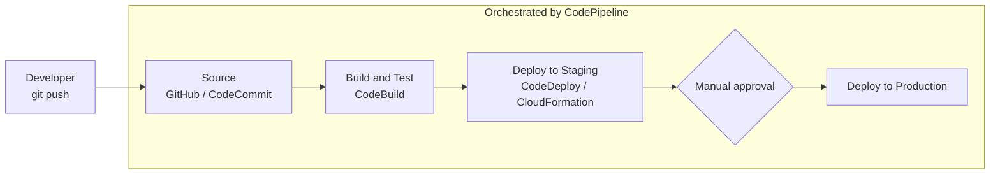
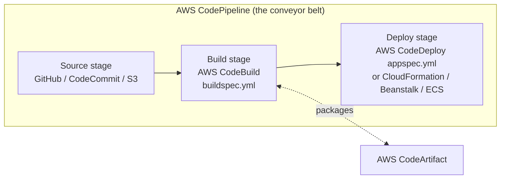
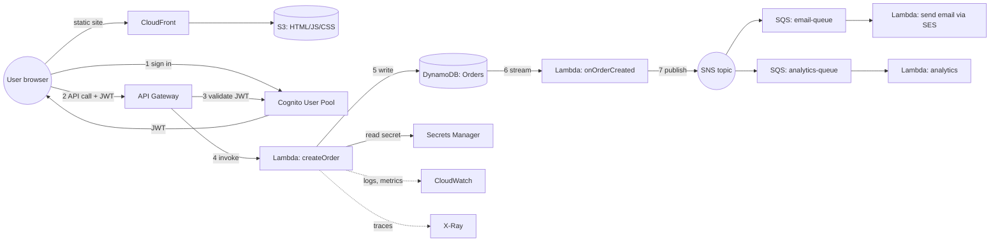
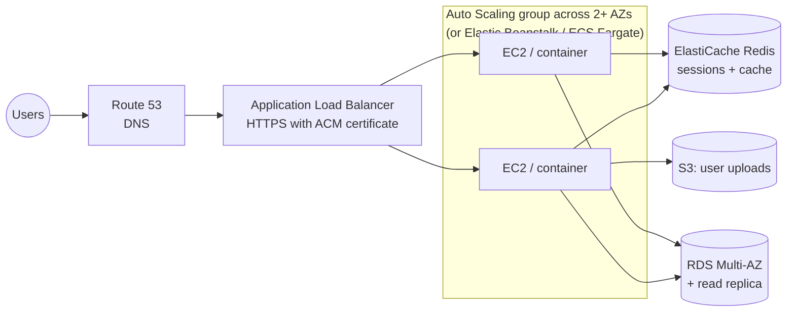
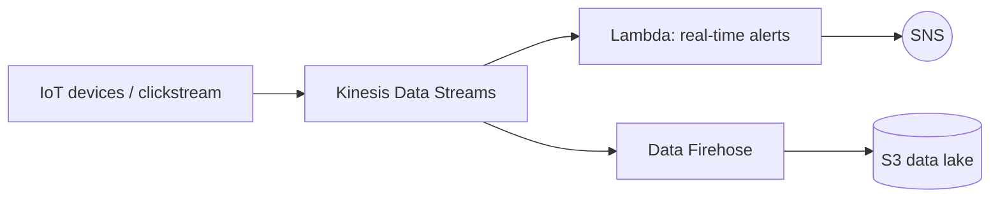

# Beginner Guide, Part 3: Developer Tools, Deployment, Monitoring, and Putting It All Together

> Previous: [Part 2](02-Integration-APIs-Security.md) · Back to [Part 1](01-Cloud-Basics-Networking-Compute-Storage-Databases.md)

---

## 1. Core ideas: CI/CD and Infrastructure as Code

### 1.1 CI/CD
- **Continuous Integration (CI):** every time a developer pushes code, it is **automatically built and tested**, so problems are found early.
- **Continuous Delivery (CD):** every change that passes the tests is **automatically prepared for release** and deployed to test or staging, with production deployment needing a manual approval.
- **Continuous Deployment:** like continuous delivery, but production deployment is also automatic.



**Analogy:** A **car factory assembly line**. Parts (code) enter at one end, go through automated stations (build, test, quality check, paint), and come out as a finished car (deployed app), the same way every time.

### 1.2 Infrastructure as Code (IaC)
- Instead of clicking in the console to create resources, you **describe your infrastructure in text files** (templates or code), keep them in Git, and let a tool create everything.
- Benefits: **repeatable** (create identical dev, test, and prod environments), **version-controlled**, **reviewable**, **easy to delete and recreate**, and no forgotten manual steps.
- **Analogy:** An **architect's blueprint**. Give the same blueprint to any builder and you get the same house.

AWS IaC tools: **CloudFormation** (the foundation), **SAM** (a serverless shorthand on top of CloudFormation), and **CDK** (real programming languages that generate CloudFormation).

---

## 2. AWS CloudFormation

**What it is:** AWS's native **Infrastructure as Code** service. You write a **template** (YAML or JSON) that declares the resources you want, and CloudFormation **creates, updates, or deletes them together as a unit called a stack**, in the right order, rolling back automatically if something fails.

**Key concepts:**
| Term | Meaning |
|---|---|
| **Template** | A YAML/JSON file describing resources |
| **Stack** | The set of resources created from one template. Deleting the stack deletes all its resources. |
| **Parameters** | Inputs that make templates reusable (e.g., `Environment = dev` or `prod`) |
| **Resources** | The AWS things to create. **This is the only required section.** |
| **Outputs** | Values to show or export (e.g., the API URL) |
| **Mappings / Conditions** | Lookup tables and if-logic |
| **Intrinsic functions** | Helpers like `!Ref` (reference another resource or parameter), `!GetAtt` (get an attribute, such as an ARN), `!Sub` (string substitution) |
| **Change set** | A **preview** of what an update will change before you apply it |
| **Rollback** | If creation or update fails, CloudFormation **automatically restores** the previous state |
| **Drift detection** | Finds resources changed manually outside CloudFormation |
| **StackSets** | Deploy the same stack to many accounts and Regions |
| **Nested stacks** | Stacks inside stacks, for reusable components |

**Example template:** an S3 bucket and a DynamoDB table.
```yaml
AWSTemplateFormatVersion: "2010-09-09"
Description: My first stack
Parameters:
  Env:
    Type: String
    AllowedValues: [dev, prod]
Resources:
  UploadsBucket:
    Type: AWS::S3::Bucket
    Properties:
      BucketName: !Sub "myapp-uploads-${Env}-${AWS::AccountId}"
  OrdersTable:
    Type: AWS::DynamoDB::Table
    Properties:
      BillingMode: PAY_PER_REQUEST
      AttributeDefinitions:
        - { AttributeName: customerId, AttributeType: S }
        - { AttributeName: orderDate, AttributeType: S }
      KeySchema:
        - { AttributeName: customerId, KeyType: HASH }    # partition key
        - { AttributeName: orderDate, KeyType: RANGE }    # sort key
Outputs:
  BucketName:
    Value: !Ref UploadsBucket
  TableArn:
    Value: !GetAtt OrdersTable.Arn
```
```bash
aws cloudformation deploy --template-file template.yaml --stack-name myapp-dev --parameter-overrides Env=dev
```

**What happens:** CloudFormation reads the template, works out dependencies, calls the S3 and DynamoDB APIs for you, and reports progress as **stack events** (`CREATE_IN_PROGRESS`, then `CREATE_COMPLETE`, or `ROLLBACK_COMPLETE` if something fails).

---

## 3. AWS SAM (Serverless Application Model)

**What it is:** An **extension of CloudFormation** that makes serverless apps (Lambda, API Gateway, DynamoDB, Step Functions) **much shorter to define**, plus a **CLI** to build, **test locally**, and deploy them.

**Why:** In plain CloudFormation, a Lambda function with an API needs about 6 resources: the function, a role, the API, a method, a permission, and a deployment. In SAM, it's a few lines.

**Example:**
```yaml
AWSTemplateFormatVersion: "2010-09-09"
Transform: AWS::Serverless-2016-10-31     # this line makes it a SAM template
Resources:
  HelloFunction:
    Type: AWS::Serverless::Function
    Properties:
      Runtime: python3.12
      Handler: app.lambda_handler
      CodeUri: src/
      Events:
        HelloApi:
          Type: Api                         # SAM creates the API Gateway for you
          Properties: { Path: /hello, Method: get }
      Policies:
        - DynamoDBReadPolicy: { TableName: !Ref Table }   # SAM creates the IAM role
  Table:
    Type: AWS::Serverless::SimpleTable
```

**SAM CLI workflow:**
```bash
sam init                 # create a starter project
sam build                # install dependencies, prepare artifacts
sam local invoke HelloFunction -e event.json   # run the function locally in Docker
sam local start-api      # run the API locally at http://127.0.0.1:3000
sam deploy --guided      # package, upload to S3, deploy via CloudFormation
sam logs -n HelloFunction --tail
```

SAM can also do **safe deployments**: it shifts traffic gradually to a new Lambda version (e.g., 10% first) and **automatically rolls back** if alarms fire (it uses CodeDeploy under the hood).

---

## 4. AWS CDK (Cloud Development Kit)

**What it is:** Define infrastructure using **real programming languages** (TypeScript, Python, Java, C#, Go). You get loops, conditions, classes, IDE autocompletion, and type checking. The CDK **synthesizes** (generates) a CloudFormation template and deploys it.

**Example (Python):**
```python
from aws_cdk import App, Stack, aws_lambda as _lambda, aws_dynamodb as ddb
from constructs import Construct

class MyStack(Stack):
    def __init__(self, scope: Construct, id: str, **kwargs):
        super().__init__(scope, id, **kwargs)
        table = ddb.Table(self, "Orders",
            partition_key=ddb.Attribute(name="customerId", type=ddb.AttributeType.STRING))
        fn = _lambda.Function(self, "Handler",
            runtime=_lambda.Runtime.PYTHON_3_12, handler="app.handler",
            code=_lambda.Code.from_asset("src"),
            environment={"TABLE_NAME": table.table_name})
        table.grant_read_write_data(fn)    # one line creates the correct IAM permissions

app = App(); MyStack(app, "MyStack"); app.synth()
```
```bash
cdk bootstrap   # one-time per account/Region: creates S3 bucket + roles CDK needs
cdk synth       # generate the CloudFormation template
cdk diff        # compare with what is deployed
cdk deploy      # deploy
```

**Constructs** are the building blocks:
- **L1:** raw CloudFormation resources (`CfnBucket`).
- **L2:** friendly classes with sensible defaults (`Bucket`, with methods like `grantRead`).
- **L3:** patterns, i.e., multi-resource architectures in one line (e.g., a load-balanced Fargate service).

---

## 5. AWS developer tools (the "Code*" family)



### 5.1 AWS CodeCommit
**What it is:** A managed **private Git repository** service, similar to GitHub. **Note:** AWS stopped accepting new CodeCommit customers in 2024, so most teams now use **GitHub, GitLab, or Bitbucket** connected to AWS through **CodeConnections**. It may still appear in exam questions.

### 5.2 AWS CodeBuild
**What it is:** A fully managed **build server**. It spins up a fresh container, downloads your source code, runs your **build commands** (compile, run tests, build a Docker image), produces **artifacts** (e.g., a zip or image), and shuts down. You pay per build minute, with no Jenkins servers to maintain.

**Analogy:** A **rentable workshop** that appears when you need to build something and disappears afterward.

Instructions go in **`buildspec.yml`** at the root of your repository:
```yaml
version: 0.2
phases:
  install:
    runtime-versions: { python: 3.12 }
    commands: [pip install -r requirements.txt]
  build:
    commands: [pytest, sam build]
  post_build:
    commands: [echo "Build finished"]
artifacts:
  files: ['**/*']
```

### 5.3 AWS CodeDeploy
**What it is:** A service that **automates deploying application code** to **EC2 instances, on-premises servers, Lambda functions, or ECS services**, with strategies for rolling out gradually and **rolling back automatically** on failure.

- For **EC2/on-premises**, you install the **CodeDeploy agent** on each server. The agent downloads the new version and runs your scripts.
- Instructions go in **`appspec.yml`**: which files to copy where, and which scripts to run at each **lifecycle hook** (e.g., `BeforeInstall`: stop the old app; `AfterInstall`: set permissions; `ApplicationStart`: start the app; `ValidateService`: check that it works).
- **Deployment styles:**
  - **In-place:** update existing servers a few at a time (e.g., one at a time, or half at a time).
  - **Blue/green:** create new servers (green) with the new version, switch traffic from old (blue) to new, and keep the old ones for quick rollback.
  - For **Lambda and ECS:** **canary** (e.g., 10% of traffic for 5 minutes, then 100%) or **linear** (e.g., add 10% every minute).

### 5.4 AWS CodePipeline
**What it is:** The **orchestrator** that connects everything into an automated release process. A pipeline has **stages** (Source → Build → Test → Deploy → Approval → Deploy to prod), and each stage has **actions** that use CodeBuild, CodeDeploy, CloudFormation, Elastic Beanstalk, ECS, Lambda, manual approvals, and more. Files pass between stages as **artifacts** stored in S3.

**Analogy:** The **assembly line conveyor belt** that moves the product from station to station.

### 5.5 AWS CodeArtifact
**What it is:** A private **package repository** for npm, pip (PyPI), Maven, NuGet, and others. It stores your company's internal libraries and caches public packages, so builds are faster and more reliable.

### 5.6 AWS AppConfig
**What it is:** Part of Systems Manager. It manages **application configuration and feature flags** that you can change **at runtime without redeploying code**, with validation and gradual rollout (and automatic rollback if alarms fire).

---

## 6. Monitoring and observability

### 6.0 The three pillars of observability

| Pillar | What it is | Example | AWS service |
|---|---|---|---|
| **Metrics** | Numbers over time | CPU 75%, 120 errors/min | **CloudWatch Metrics** |
| **Logs** | Text records of events | `ERROR Payment failed for order 42` | **CloudWatch Logs** |
| **Traces** | The path of one request through many services | API → Lambda → DynamoDB took 900 ms, and 800 ms was the DynamoDB call | **AWS X-Ray** |

Plus **auditing** (who changed what), handled by **CloudTrail**.

### 6.1 Amazon CloudWatch
**What it is:** AWS's central **monitoring service**. It collects **metrics** and **logs** from AWS services and your apps, lets you build **dashboards**, and triggers **alarms** that notify you or take automatic action.

**Analogy:** A **car dashboard and warning lights**: the speedometer and fuel gauge (metrics), the trip log (logs), and the check-engine light (alarms).

**Parts of CloudWatch:**
| Feature | What it does |
|---|---|
| **Metrics** | Time-series numbers. AWS services publish them automatically (Lambda invocations, errors, duration; EC2 CPU; DynamoDB throttles). You can publish **custom metrics** (e.g., orders per minute). |
| **Namespace / dimension** | A metric's "folder" (e.g., `AWS/Lambda`) and its labels (e.g., `FunctionName=checkout`) |
| **Alarms** | Watch a metric and act when it crosses a threshold: send a notification through **SNS**, scale an Auto Scaling group, or stop or reboot EC2. States: `OK`, `ALARM`, `INSUFFICIENT_DATA`. |
| **Logs** | Stores log lines in **log groups** (one per app or function) and **log streams** (one per instance or container). Lambda logs automatically. |
| **Logs Insights** | A query language for searching and analyzing logs |
| **Metric filters** | Turn log patterns (e.g., the word "ERROR") into metrics you can alarm on |
| **Subscription filters** | Stream logs in real time to Lambda, Kinesis, or Firehose |
| **Dashboards** | Custom graphs |
| **CloudWatch agent** | Installed on EC2 or on-premises servers to send **memory and disk metrics** and **log files** |
| **Synthetics canaries** | Scripts that test your website or API every few minutes, like a robot user |

**Example:** alarm when a Lambda function has more than 5 errors in 1 minute, then email the team via SNS.

### 6.2 AWS X-Ray
**What it is:** A **distributed tracing** service. It follows **individual requests** as they travel through your services (API Gateway → Lambda → DynamoDB → SNS ...), measuring how long each step takes and where errors happen. It draws a **service map** of your architecture.

**Analogy:** **Package tracking**. You can see every hub the package passed through, how long it stayed at each one, and where it got stuck.

**Key concepts:**
| Term | Meaning |
|---|---|
| **Trace** | The full journey of one request, identified by a **trace ID** passed along in an HTTP header |
| **Segment** | The work done by one service |
| **Subsegment** | A detail inside a segment (e.g., a single DynamoDB call) |
| **Annotations** | Key-value data you add that is **indexed and searchable** (e.g., `customerId=C001`) |
| **Metadata** | Extra data that is **not searchable** |
| **Sampling** | Only a portion of requests is traced, to control cost |
| **X-Ray daemon** | A small agent that collects trace data from the SDK and sends it to X-Ray. It is built into Lambda; on EC2 or ECS you run it yourself. |
| **Service map** | A visual graph of services with latency and error rates |

**How to enable it:** turn on "Active tracing" for Lambda or tracing on API Gateway stages. For EC2 or ECS, run the X-Ray daemon and instrument your code with the X-Ray SDK or OpenTelemetry (ADOT). The role also needs permission to send traces.

### 6.3 AWS CloudTrail
**What it is:** Records **every API call made in your AWS account**: who made it, when, from which IP, what was requested, and whether it succeeded. It is used for **security auditing, compliance, and troubleshooting** ("who deleted my table?").

**Analogy:** A **security camera with a logbook** at every door of your account.

- Enabled by default, with **90 days** of history viewable in the console.
- Create a **trail** to store logs long-term in S3.
- **Management events** (create, delete, or modify resources) are logged by default. **Data events** (e.g., every S3 object read) are optional.

### 6.4 CloudWatch vs X-Ray vs CloudTrail

| Question you're asking | Service |
|---|---|
| "Is my app healthy? Alert me when errors spike." | **CloudWatch** |
| "Why is this request slow? Which microservice fails?" | **X-Ray** |
| "Who changed or deleted this resource, and when?" | **CloudTrail** |

---

## 7. Putting it all together: example architectures

### 7.1 Serverless web application (the most common exam scenario)


**Walk-through of one request:**
1. The user loads the website from **CloudFront**, which serves static files cached from a private **S3** bucket.
2. The user signs in with **Cognito user pools** and receives a JWT.
3. The browser calls `POST /orders` on **API Gateway** with the JWT. API Gateway checks the token with Cognito and applies throttling.
4. API Gateway invokes the **Lambda** function `createOrder`. Its **IAM execution role** allows it to write to the table and read the payment API key from **Secrets Manager**.
5. Lambda writes the order to **DynamoDB** and returns `201 Created`.
6. **DynamoDB Streams** triggers another Lambda function asynchronously, which publishes an `OrderCreated` event to **SNS**.
7. SNS **fans out** to two **SQS** queues: one for sending a confirmation email (via SES) and one for analytics. Each is processed independently, with retries and a DLQ.
8. Everything logs to **CloudWatch Logs**, metrics and alarms live in **CloudWatch**, and **X-Ray** shows the trace across services. **CloudTrail** audits configuration changes.
9. The whole stack is defined in a **SAM template**, and a **CodePipeline** builds it with **CodeBuild** and deploys it via CloudFormation, with **canary** traffic shifting for Lambda.

### 7.2 Traditional (server-based) web application

- **Route 53** resolves the domain to the **ALB**.
- The ALB spreads traffic over instances in **multiple AZs**. The **Auto Scaling group** adds or removes instances as load changes.
- Sessions live in **ElastiCache**, so any instance can serve any user (the app is stateless).
- **RDS Multi-AZ** provides high availability, and a **read replica** handles reporting queries.
- Uploads go to **S3**. Instances access S3 through an **IAM role**, not stored keys.
- **Elastic Beanstalk** could create this whole setup for you from just your code.

### 7.3 Data streaming pipeline


---

## 8. Glossary (A–Z)

| Term | Meaning |
|---|---|
| **Alias (Lambda)** | Named pointer to a function version (e.g., `prod`) |
| **AMI** | Machine image used to launch EC2 instances |
| **ARN** | Amazon Resource Name: a unique ID for any AWS resource |
| **Artifact** | A build output (zip, Docker image) passed between pipeline stages |
| **Availability Zone (AZ)** | An isolated data center (or group of them) within a Region |
| **Blue/green deployment** | Run old (blue) and new (green) side by side, then switch traffic |
| **Canary deployment** | Send a small % of traffic to the new version first |
| **CIDR** | IP range notation, e.g., `10.0.0.0/16` |
| **Cold start** | Delay when Lambda creates a new execution environment |
| **Concurrency** | Number of simultaneous Lambda executions |
| **Dead-letter queue (DLQ)** | Where messages or events go after repeated failures |
| **Decoupling** | Separating components with queues or events so they don't depend on each other directly |
| **Edge location** | CDN/DNS site close to users |
| **Envelope encryption** | Encrypt data with a data key, and encrypt the data key with a KMS key |
| **Event** | A JSON record that something happened |
| **Eventually consistent** | A read may briefly return old data |
| **Execution role** | IAM role a Lambda function uses to call AWS services |
| **Fan-out** | One message delivered to many consumers |
| **High availability (HA)** | The system keeps working when a component fails (multi-AZ) |
| **Idempotent** | Doing the same operation twice has the same result as doing it once |
| **Instance profile** | Container that attaches an IAM role to an EC2 instance |
| **JWT** | JSON Web Token: a signed token proving a user's identity (from Cognito) |
| **Latency** | Time taken to respond |
| **Least privilege** | Grant only the minimum permissions required |
| **Partition key** | DynamoDB attribute that decides where an item is stored |
| **Presigned URL** | Temporary URL granting access to a private S3 object |
| **Principal** | The identity (user, role, service, account) making a request or named in a policy |
| **Region** | A geographic area containing multiple AZs |
| **Rollback** | Return to the previous working version |
| **Serverless** | You don't manage servers; it scales automatically and you pay per use |
| **Shard** | A Kinesis capacity unit |
| **Stack** | A group of resources managed together by CloudFormation |
| **Stage (API Gateway)** | A named deployment of an API (dev, prod) |
| **Stateless** | The server keeps no user data between requests |
| **Strongly consistent** | A read always returns the latest data |
| **Throttling** | Rejecting requests over a rate limit (HTTP 429) |
| **TTL** | Time to live: how long data stays before it expires |
| **Version (Lambda)** | Immutable snapshot of function code and config |
| **Visibility timeout** | How long an SQS message stays hidden while being processed |
| **VPC** | Your private network in AWS |

---

## 9. First hands-on steps for a complete beginner

Do these before starting the domain files. Each takes 15–45 minutes.

1. **Create an AWS account.** Enable **MFA on the root user**, then create an **AWS Budget** (e.g., $5 with an email alert).
2. **Create an admin identity** for daily use (IAM Identity Center user, or an IAM user with MFA). Stop using root.
3. **Install the AWS CLI**, run `aws configure` (or `aws configure sso`), then run `aws sts get-caller-identity` to confirm it works.
4. **S3:** create a bucket, upload a file, generate a presigned URL, and open it in a browser.
5. **Lambda:** create a "Hello World" Python function in the console, test it with a test event, and look at the logs in **CloudWatch Logs**.
6. **API Gateway:** create an HTTP API with a route to your Lambda function and call it with a browser or `curl`.
7. **DynamoDB:** create a table (`customerId` + `orderDate`), add items in the console, then read them from Lambda with boto3. You'll need to add permissions to the Lambda **execution role**.
8. **SQS/SNS:** create a topic and two queues, subscribe the queues, publish a message, and see it arrive in both.
9. **SAM:** install the SAM CLI, run `sam init` with the Hello World template, then `sam build`, `sam local invoke`, and `sam deploy --guided`. Afterward, run `sam delete`.
10. **Clean up** resources after each lab, and check **Billing → Bills** weekly.

When these feel comfortable, continue with the [Study Plan](../00-Study-Plan.md) and the domain files.
