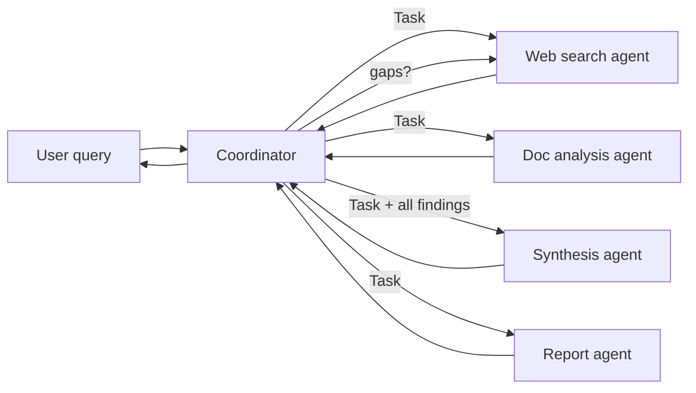

# Claude Certified Architect – Foundations (CCAR-F) — Complete Study Plan

> Built from `ExamGuide.pdf` (v1.0, effective July 2026). Everything marked **[Guide]** is stated directly in the official guide and is the "exam truth". Code snippets are illustrative — the exam tests architecture judgement, not exact syntax (language/framework detail is explicitly out of scope).

---

## Table of Contents

1. [Exam at a Glance](#1-exam-at-a-glance)
2. [Study Schedule (4 weeks + 2-week fast track)](#2-study-schedule)
3. [The 12 Golden Rules (how the exam "thinks")](#3-the-12-golden-rules)
4. [Domain 1 — Agentic Architecture & Orchestration (27%)](#4-domain-1--agentic-architecture--orchestration-27)
5. [Domain 2 — Tool Design & MCP Integration (18%)](#5-domain-2--tool-design--mcp-integration-18)
6. [Domain 3 — Claude Code Configuration & Workflows (20%)](#6-domain-3--claude-code-configuration--workflows-20)
7. [Domain 4 — Prompt Engineering & Structured Output (20%)](#7-domain-4--prompt-engineering--structured-output-20)
8. [Domain 5 — Context Management & Reliability (15%)](#8-domain-5--context-management--reliability-15)
9. [Scenario Playbooks (the 6 exam scenarios)](#9-scenario-playbooks)
10. [Hands-on Labs](#10-hands-on-labs)
11. [Official Sample Questions — Pattern Analysis](#11-official-sample-questions--pattern-analysis)
12. [Extra Practice Questions (with answers)](#12-extra-practice-questions)
13. [One-Page Cheat Sheet](#13-one-page-cheat-sheet)
14. [Out of Scope — Don't Waste Time](#14-out-of-scope)
15. [Exam-Day Strategy & Logistics](#15-exam-day-strategy--logistics)
16. [Progress Tracker](#16-progress-tracker)

---

## 1. Exam at a Glance

| Item | Detail |
|---|---|
| Credential / code | Claude Certified Architect – Foundations / **CCAR-F** |
| Items | **60** multiple-choice + multiple-response (each item says how many to pick) |
| Structure | **4 scenarios** randomly chosen from a bank of **6** |
| Time | **120 minutes** → ~2 min per item |
| Passing | Scaled **720** on 100–1,000 (criterion-referenced, not curved) |
| Fee / validity | $125 USD / 12 months (free on-time renewal assessment) |
| Retakes | Wait 14 → 30 → 90 days; max 4 attempts in rolling 12 months |
| Delivery | Pearson VUE — online proctored or test centre |

### Domain weights → how many questions to expect (of 60)

| # | Domain | Weight | ≈ Items | Study time share |
|---|---|---|---|---|
| 1 | Agentic Architecture & Orchestration | 27% | ~16 | Highest |
| 3 | Claude Code Configuration & Workflows | 20% | ~12 | High |
| 4 | Prompt Engineering & Structured Output | 20% | ~12 | High |
| 2 | Tool Design & MCP Integration | 18% | ~11 | Medium-high |
| 5 | Context Management & Reliability | 15% | ~9 | Medium (but appears in 4 of 6 scenarios!) |

> Domain 5 is only 15% by weight, but it is a *primary domain* in Scenarios 1, 2, 3 and 6. Its ideas (structured errors, escalation, provenance) leak into many other questions. Do not under-study it.

---

## 2. Study Schedule

### Option A — 4 weeks (~1.5–2 h/day, recommended)

| Week | Days | Focus | Output |
|---|---|---|---|
| **1** | 1 | Read guide end-to-end + Section 3 of this plan (Golden Rules) | Notes on rules |
| | 2–3 | Domain 1: 1.1 agentic loop, 1.2–1.3 coordinator/subagents | Lab 1 started |
| | 4–5 | Domain 1: 1.4 enforcement/handoff, 1.5 hooks | Hook implemented |
| | 6 | Domain 1: 1.6 decomposition, 1.7 sessions | Flashcards |
| | 7 | Review + practice Qs for Domain 1 | Score ≥ 80% |
| **2** | 8–9 | Domain 2: 2.1 tool descriptions, 2.2 structured errors | Lab 1 finished |
| | 10 | Domain 2: 2.3 tool distribution & tool_choice | |
| | 11 | Domain 2: 2.4 MCP config, 2.5 built-in tools | `.mcp.json` working |
| | 12–13 | Domain 3: 3.1 CLAUDE.md, 3.2 commands/skills, 3.3 rules | Lab 2 |
| | 14 | Review Domain 2 + 3.1–3.3 | |
| **3** | 15 | Domain 3: 3.4 plan mode, 3.5 iterative refinement | |
| | 16 | Domain 3: 3.6 CI/CD (`-p`, `--output-format json`, `--json-schema`) | CI script |
| | 17–18 | Domain 4: 4.1 explicit criteria, 4.2 few-shot, 4.3 tool_use + schemas | Lab 3 started |
| | 19–20 | Domain 4: 4.4 validation-retry, 4.5 batches, 4.6 multi-pass review | Lab 3 finished |
| | 21 | Review Domain 3 + 4 | |
| **4** | 22–23 | Domain 5: 5.1 context, 5.2 escalation, 5.3 error propagation | |
| | 24 | Domain 5: 5.4 large codebase, 5.5 human review, 5.6 provenance | Lab 4 |
| | 25 | Scenario playbooks (Section 9) — all 6 | |
| | 26 | All sample + practice questions, timed (2 min/q) | |
| | 27 | Weak-area review using cheat sheet | |
| | 28 | Light review, logistics check, rest | |

### Option B — 2-week fast track (~3 h/day)

| Days | Focus |
|---|---|
| 1 | Guide + Golden Rules + Domain 1 (1.1–1.3) |
| 2 | Domain 1 (1.4–1.7) + Lab 1 hook |
| 3 | Domain 2 complete |
| 4 | Domain 3 (3.1–3.3) + Lab 2 |
| 5 | Domain 3 (3.4–3.6) |
| 6 | Domain 4 (4.1–4.3) |
| 7 | Domain 4 (4.4–4.6) + Lab 3 |
| 8 | Domain 5 complete |
| 9 | Lab 4 (multi-agent research) |
| 10 | Scenario playbooks |
| 11 | Practice questions (timed) |
| 12 | Weak areas |
| 13 | Cheat sheet only |
| 14 | Rest / exam |

---

## 3. The 12 Golden Rules

Almost every question on this exam is a "what is the **best / most effective / first** change?" question with 4 plausible options. These rules — derived from the guide's explanations — eliminate wrong answers quickly.

| # | Rule | Typical correct answer | Typical wrong answer |
|---|---|---|---|
| 1 | **Deterministic beats probabilistic when stakes are high** | Hook / programmatic gate / prerequisite check | "Make the system prompt say it's mandatory" |
| 2 | **Fix the root cause shown in the evidence** | The component the logs point at | Blaming downstream agents that worked correctly |
| 3 | **Proportionate first step** | Better tool description / explicit criteria / few-shot | New classifier model, routing layer, re-architecture |
| 4 | **Explicit > implicit** | Explicit criteria, explicit context passing, explicit escalation rules | "Be conservative", "use your judgement", hoping subagents inherit context |
| 5 | **Structured > generic** | Structured error metadata, structured handoffs, claim-source mappings | "Operation failed", "search unavailable", prose dumps |
| 6 | **Never hide failure as success** | Distinguish access failure vs valid empty result | Return empty list marked success |
| 7 | **Don't kill the whole workflow for one failure** | Proceed with partial results + annotate gaps | Terminate entire pipeline |
| 8 | **Least privilege for tools** | 4–5 scoped tools per agent; scoped cross-role tool for common case | Give every agent every tool |
| 9 | **Isolate context** | Subagent / Explore / `context: fork` / independent reviewer | Do everything in one long session |
| 10 | **Bigger context window ≠ better attention** | Split into focused passes | "Use a bigger model/window" |
| 11 | **Self-reported confidence & sentiment are unreliable proxies** | Explicit criteria; calibrated confidence with labelled data | "Escalate if confidence < 7", sentiment thresholds |
| 12 | **Match the tool to latency needs** | Batch API for overnight; sync for blocking | Batch for pre-merge checks |

**Distractor smells** (options that are usually wrong):
- Invented features: `CLAUDE_HEADLESS=true`, `--batch` flag, `.claude/config.json` with a `commands` array.
- "Require developers to…" (shifts burden to humans instead of fixing the system).
- "Run N times and take majority vote" (suppresses real but intermittent findings).
- "Arbitrary iteration cap as the primary stop condition".
- "Parse the assistant's text for 'done'/'complete'".
- "Over-engineered" infrastructure when a prompt/description fix hasn't been tried.

---

## 4. Domain 1 — Agentic Architecture & Orchestration (27%)

### 1.1 Agentic loops for autonomous task execution

**Concept.** An agentic loop is the controller code around the model:

1. Send `messages` (+ `tools`, `system`) to Claude.
2. Inspect **`stop_reason`**:
   - `"tool_use"` → the model wants tools executed. Run every `tool_use` block, append results, loop again.
   - `"end_turn"` → the model has finished. Exit and present the final answer.
3. Tool results are appended to the **conversation history** (as a `user` message containing `tool_result` blocks keyed by `tool_use_id`) so the model can reason over them next iteration.

**Model-driven vs pre-configured.** In an agent, *Claude* decides which tool to call next based on context. A hard-coded decision tree/tool sequence is a workflow, not an agent. The exam favours model-driven decisions **except** where business rules require guaranteed ordering (then use programmatic enforcement — see 1.4).

```python
import json, anthropic
client = anthropic.Anthropic()

messages = [{"role": "user", "content": user_request}]
while True:
    resp = client.messages.create(
        model=MODEL, max_tokens=4096, system=SYSTEM_PROMPT,
        tools=TOOLS, messages=messages,
    )
    # 1. Always append the assistant turn (contains the tool_use blocks)
    messages.append({"role": "assistant", "content": resp.content})

    if resp.stop_reason == "tool_use":
        results = []
        for block in resp.content:
            if block.type == "tool_use":
                output, failed = execute_tool(block.name, block.input)
                results.append({
                    "type": "tool_result",
                    "tool_use_id": block.id,          # must match
                    "content": json.dumps(output),
                    "is_error": failed,
                })
        # 2. Return ALL results in one user message, then iterate
        messages.append({"role": "user", "content": results})
        continue

    if resp.stop_reason == "end_turn":
        break                                         # 3. Done
    # Other stop reasons (e.g. "max_tokens") need explicit handling, not silent success
    handle_other_stop_reason(resp)
    break
```

**Anti-patterns the guide names explicitly [Guide]:**
- Parsing natural language ("I'm done", "Task complete") to decide termination.
- Using an **arbitrary iteration cap as the *primary*** stopping mechanism (a safety cap as a backstop is fine; it just must not be *the* mechanism).
- Treating "the response contains text" as a completion signal (Claude can emit text *and* `tool_use` in the same turn).

**Exam traps:**
- "The loop exits early when Claude says 'Let me check that…'" → caused by checking for text content instead of `stop_reason`.
- Forgetting to append the assistant message before the tool results → model loses track of its own call.

---

### 1.2 Coordinator–subagent (hub-and-spoke) orchestration

**Concept.** A **coordinator** agent sits in the middle; **subagents** are spokes. The coordinator:
- **Decomposes** the task, **delegates**, **aggregates** results.
- **Decides which subagents to invoke** based on query complexity — it does *not* always run the full pipeline.
- Handles **all inter-subagent communication**, error handling and routing (observability + consistent error handling + controlled information flow).

**Subagents have isolated context.** They do **not** inherit the coordinator's conversation history. Whatever they need must be in their prompt.

**Key risk — overly narrow decomposition.** If the coordinator splits "AI in creative industries" into "digital art / graphic design / photography", every subagent can succeed and the report still misses music, writing and film. Root cause = coordinator decomposition (official sample Q7).

**Skills:**
- Partition scope across subagents to **minimise duplication** (distinct subtopics or source types per agent).
- **Iterative refinement loop:** coordinator evaluates synthesis for gaps → re-delegates targeted queries to search/analysis → re-runs synthesis until coverage is sufficient.
- Dynamic selection: simple factual question → maybe only one subagent; broad research → full fan-out.



**Exam traps:** Subagents talking directly to each other (peer-to-peer) loses observability — prefer routing through the coordinator.

---

### 1.3 Subagent invocation, context passing and spawning

| Fact [Guide] | What it means |
|---|---|
| **Task tool** spawns subagents | The coordinator calls a tool named `Task` |
| `allowedTools` **must include `"Task"`** | Otherwise the coordinator cannot spawn subagents (classic "why won't it delegate?" question) |
| Context must be **explicitly** put in the subagent prompt | No automatic inheritance, no shared memory between invocations |
| **AgentDefinition** = description + system prompt + tool restrictions | Per subagent type |
| **Fork-based sessions** | Explore divergent approaches from a shared baseline |

```python
# Illustrative Claude Agent SDK configuration
from claude_agent_sdk import ClaudeAgentOptions, AgentDefinition

options = ClaudeAgentOptions(
    allowed_tools=["Task", "Read", "Grep"],   # "Task" is REQUIRED to delegate
    agents={
        "web-search": AgentDefinition(
            description="Searches the public web for recent sources on a sub-topic. "
                        "Use for discovering NEW sources; not for analysing provided PDFs.",
            prompt="You are a web research specialist. Return findings as JSON: "
                   "[{claim, evidence_excerpt, source_url, publication_date}]",
            tools=["WebSearch", "WebFetch"],
        ),
        "synthesis": AgentDefinition(
            description="Combines findings supplied in the prompt into a cited report section.",
            prompt="Preserve every claim→source mapping. Flag conflicts; never pick one silently.",
            tools=["verify_fact"],              # scoped cross-role tool (see 2.3)
        ),
    },
)
```

**Skills:**
- Pass **complete findings** from earlier agents directly in the next subagent's prompt (e.g., give synthesis both the search results and the document analysis).
- Use **structured formats separating content from metadata** (source URL, doc name, page number) to preserve attribution.
- **Parallelism:** emit **multiple Task calls in a single coordinator response** → they run in parallel. Spreading them over separate turns makes them sequential.
- Coordinator prompts should specify **goals and quality criteria**, not step-by-step procedures — subagents adapt better.

---

### 1.4 Multi-step workflows: enforcement and handoff

**Programmatic enforcement vs prompt guidance.**

| | Prompt-based ("always verify first") | Programmatic (hooks, prerequisite gates) |
|---|---|---|
| Nature | Probabilistic | Deterministic |
| Failure rate | **Non-zero** — even well-written prompts get skipped sometimes | Zero for the enforced rule |
| Use when | Style, preferences, soft guidance | Identity verification before money moves, compliance, legal |

**Prerequisite gate example:** block `lookup_order` / `process_refund` until `get_customer` has returned a **verified customer ID** (official sample Q1 — 12% of cases skipped verification).

```python
session_state = {"verified_customer_id": None}

def gate(tool_name, tool_input):
    if tool_name in {"lookup_order", "process_refund"} and not session_state["verified_customer_id"]:
        return {"blocked": True,
                "reason": "Call get_customer and verify identity before order operations."}
    return {"blocked": False}
```

**Multi-concern requests.** "My order arrived broken AND I was double-charged" → decompose into distinct items, investigate each (in parallel, with shared context such as the customer ID), then synthesise **one** unified resolution.

**Structured handoff to humans.** Human agents **do not see the transcript**. Escalation must carry a self-contained summary:

```json
{
  "customer_id": "C-88213",
  "issue_summary": "Duplicate charge on order #4471",
  "root_cause": "Payment gateway retried after timeout; two captures recorded",
  "actions_taken": ["Verified identity", "Confirmed two captures of $129.99"],
  "refund_amount": 129.99,
  "recommended_action": "Approve refund of second capture (exceeds agent limit)",
  "customer_expectation": "Refund within 3 business days"
}
```

---

### 1.5 Agent SDK hooks — interception & normalisation

Two hook families matter:

| Hook | When | Use for |
|---|---|---|
| **Pre-tool-call interception** (e.g., `PreToolUse`) | Before the tool runs | **Block/redirect** policy-violating calls (refund > $500 → deny + escalate) |
| **`PostToolUse`** | After the tool returns, **before the model sees the result** | **Normalise/transform** results (Unix epoch, ISO 8601, numeric status codes → one format), trim fields |

```python
# Illustrative: deny refunds over $500 and redirect to escalation
async def refund_limit(input_data, tool_use_id, context):
    if input_data["tool_input"].get("amount", 0) > 500:
        return {"hookSpecificOutput": {
            "hookEventName": "PreToolUse",
            "permissionDecision": "deny",
            "permissionDecisionReason":
                "Refunds over $500 require a human. Call escalate_to_human with a structured summary.",
        }}
    return {}

# Illustrative: normalise heterogeneous timestamps/status codes
async def normalise(input_data, tool_use_id, context):
    # convert 1719878400 / "2024-07-02T00:00:00Z" / status 3 → {"date": "2024-07-02", "status": "shipped"}
    ...
```

**Decision rule:** *business rule requires guaranteed compliance → hook.* Prompt instructions = probabilistic compliance.

---

### 1.6 Task decomposition strategies

| Pattern | When | Example |
|---|---|---|
| **Prompt chaining (fixed sequential pipeline)** | Predictable, multi-aspect work | Code review: per-file analysis → cross-file integration pass |
| **Dynamic adaptive decomposition** | Open-ended investigation; next step depends on findings | "Add comprehensive tests to a legacy codebase": map structure → find high-impact areas → prioritised plan → adapt as dependencies appear |

**Attention dilution:** reviewing 14 files in one pass gives uneven depth, missed bugs and contradictions. Fix = per-file local passes + a separate integration pass (sample Q12).

---

### 1.7 Session state, resumption and forking

| Mechanism | Purpose |
|---|---|
| `--resume <session-name>` | Continue a **named** prior conversation |
| `fork_session` | Branch independent explorations from a shared analysis baseline (e.g., compare two refactoring strategies) |
| Fresh session + **structured summary** | When old tool results are **stale** (code changed) — more reliable than resuming |

**Decision rule:**
- Prior context **mostly valid** → resume, and **tell the agent which files changed** so it re-analyses only those.
- Prior tool results **stale** → start fresh and inject a structured summary.

---

## 5. Domain 2 — Tool Design & MCP Integration (18%)

### 2.1 Tool interfaces: descriptions and boundaries

**Tool descriptions are the primary mechanism Claude uses to pick tools [Guide].** Minimal descriptions → unreliable selection among similar tools.

A good description includes: **purpose, input formats, example queries, edge cases, boundaries ("use X instead when…"), and what it returns.**

```json
{
  "name": "lookup_order",
  "description": "Retrieves a single order by order number. Use when the user mentions an order, shipment, delivery, return or an identifier like '#12345' or 'ORD-12345'. Input: order_id (digits, optional '#'/'ORD-' prefix stripped). Returns status, items, totals, ship dates. Do NOT use for customer profile/account questions — use get_customer. Returns found=false (not an error) when no order matches.",
  "input_schema": {
    "type": "object",
    "properties": { "order_id": { "type": "string", "description": "e.g. '12345'" } },
    "required": ["order_id"]
  }
}
```

**Fixes for misrouting:**
- **Rename + re-describe** overlapping tools (`analyze_content` → `extract_web_results` with a web-specific description).
- **Split** generic tools into purpose-specific ones with clear contracts (`analyze_document` → `extract_data_points`, `summarize_content`, `verify_claim_against_source`).
- **Audit the system prompt** for keyword-sensitive instructions (e.g., "whenever the user mentions *customer*, check their profile") that override good tool descriptions.

**First-step logic (sample Q2):** minimal descriptions are the root cause → expand descriptions *before* few-shot, routing layers or tool consolidation.

---

### 2.2 Structured error responses for MCP tools

MCP tools signal failure with the **`isError` flag** in the tool result. Add structured metadata so the agent can choose the right recovery:

| Category | Examples | Retryable? | Agent behaviour |
|---|---|---|---|
| **Transient** | Timeout, 503, rate-limited upstream | ✅ Yes | Retry (maybe with backoff) |
| **Validation** | Bad date format, missing field | ⚠️ After fixing input | Correct input and retry |
| **Business** | Policy violation, refund window expired | ❌ No | Explain to customer in friendly terms / escalate |
| **Permission** | Not authorised | ❌ No | Escalate / ask for authorisation |

```json
{
  "isError": true,
  "content": [{ "type": "text", "text": "{\"errorCategory\":\"business\",\"isRetryable\":false,\"message\":\"Order is 45 days old; returns allowed within 30 days.\",\"customerFacing\":\"This order is outside our 30-day return window.\"}" }]
}
```

**Key distinctions:**
- Generic "Operation failed" → agent can't decide; wastes retries on non-retryable errors.
- **Access failure ≠ valid empty result.** "Search timed out" (needs retry decision) is different from "Search succeeded, 0 matches" (a real answer).
- **Local recovery first:** subagents retry transient failures themselves; only propagate unresolved errors to the coordinator **with partial results and what was attempted**.

---

### 2.3 Distributing tools across agents & `tool_choice`

- **Too many tools degrade selection** (e.g., 18 vs 4–5) [Guide].
- Agents with tools outside their role **misuse them** (synthesis agent starts web-searching).
- **Scoped access:** each agent gets only role tools, plus **narrow cross-role tools for high-frequency needs** (e.g., `verify_fact` for synthesis — sample Q9: handles the 85% simple case while the 15% complex case still goes via the coordinator).
- **Constrain generic tools:** replace `fetch_url` with `load_document` that validates document URLs.

**`tool_choice` options:**

| Value | Behaviour | Use |
|---|---|---|
| `{"type": "auto"}` | Model may call a tool **or** reply with text | Default conversational agents |
| `{"type": "any"}` | Model **must** call *some* tool (its choice) | Guarantee structured output when several extraction schemas exist and doc type is unknown |
| `{"type": "tool", "name": "extract_metadata"}` | Model **must** call **that** tool | Force a step to run first (e.g., metadata before enrichment), then continue in follow-up turns |

---

### 2.4 Integrating MCP servers into Claude Code & agents

| Scope | File | Shared? | Use |
|---|---|---|---|
| **Project** | `.mcp.json` (repo root, committed) | ✅ via version control | Team tooling (GitHub, Jira, DB) |
| **User** | `~/.claude.json` | ❌ personal | Experimental/personal servers |

```json
// .mcp.json — committed; secrets come from the environment, never the file
{
  "mcpServers": {
    "github": {
      "command": "npx",
      "args": ["-y", "@modelcontextprotocol/server-github"],
      "env": { "GITHUB_TOKEN": "${GITHUB_TOKEN}" }
    }
  }
}
```

**Facts [Guide]:**
- **Env var expansion** (`${GITHUB_TOKEN}`) → credentials without committing secrets.
- Tools from **all configured servers** are discovered at connection time and **available simultaneously**.
- **MCP resources** expose **content catalogs** (issue summaries, doc hierarchies, DB schemas) → fewer exploratory tool calls. *Resources = data to read; tools = actions.*
- If the agent prefers built-in `Grep` over a more capable MCP tool → **improve the MCP tool's description** (capabilities + outputs).
- Prefer **existing community MCP servers** for standard integrations (Jira, GitHub); build **custom** only for team-specific workflows.

---

### 2.5 Built-in tools: Read, Write, Edit, Bash, Grep, Glob

| Tool | Purpose | Example |
|---|---|---|
| **Grep** | Search file **contents** | Find all callers of `processRefund`, error message text, imports |
| **Glob** | Match file **paths/names** | `**/*.test.tsx` |
| **Read** | Load full file | Follow imports, trace a flow |
| **Write** | Write whole file | Create file / full rewrite |
| **Edit** | Targeted change by **unique** text match | Small modification |
| **Bash** | Run commands | Tests, builds, git |

**Rules:**
- **Edit fails on non-unique anchor text → fallback: Read + Write.**
- Build understanding **incrementally**: Grep for entry points → Read to follow imports. Don't read every file upfront.
- Tracing usage through wrapper modules: first list **all exported names**, then Grep for each.

> Memory trick: **G**lob = file **G**eography (where); **G**rep = file **G**uts (what's inside).

---

## 6. Domain 3 — Claude Code Configuration & Workflows (20%)

### 3.1 CLAUDE.md hierarchy, scoping, modularity

| Level | Location | Shared via VCS? |
|---|---|---|
| **User** | `~/.claude/CLAUDE.md` | ❌ only that user |
| **Project** | `CLAUDE.md` at repo root **or** `.claude/CLAUDE.md` | ✅ |
| **Directory** | `some/subdir/CLAUDE.md` | ✅ (applies to that subtree) |

**Classic diagnostic (exam favourite):** "A new team member doesn't get the conventions" → the instructions were in **user-level** `~/.claude/CLAUDE.md`, not project-level. Move them to the project.

**Modularity:**
- `@import` (written as `@path/to/file.md`) pulls in external standards files — each package's CLAUDE.md imports only what's relevant.
- `.claude/rules/` holds **topic-specific rule files** (`testing.md`, `api-conventions.md`, `deployment.md`) instead of one huge CLAUDE.md.
- **`/memory`** command → see which memory files are loaded; diagnose inconsistent behaviour.

```markdown
<!-- packages/billing/CLAUDE.md -->
# Billing package
@../../docs/standards/money-handling.md
@../../docs/standards/api-errors.md
```

---

### 3.2 Custom slash commands and skills

| Item | Project scope (shared) | User scope (personal) |
|---|---|---|
| Slash commands | `.claude/commands/` | `~/.claude/commands/` |
| Skills | `.claude/skills/<name>/SKILL.md` | `~/.claude/skills/<name>/SKILL.md` |

**SKILL.md frontmatter options [Guide]:**

| Key | Effect |
|---|---|
| `context: fork` | Runs the skill in an **isolated sub-agent context** → verbose output / brainstorming doesn't pollute the main conversation |
| `allowed-tools` | Restricts tools during skill execution (e.g., only file writes, nothing destructive) |
| `argument-hint` | Prompts the developer for required parameters if invoked without arguments |

```markdown
---
name: analyze-codebase
description: Maps module structure and dependencies for an unfamiliar area.
context: fork
allowed-tools: Read, Grep, Glob
argument-hint: <directory-to-analyze>
---
Analyze the directory given as the argument. Return a 20-line summary of modules,
entry points and external dependencies. Do not modify files.
```

**Skills vs CLAUDE.md:**
- **CLAUDE.md** = always loaded, universal standards.
- **Skills** = on-demand, task-specific workflows.

**Personal variants:** copy to `~/.claude/skills/` **with a different name** so you don't shadow/affect teammates' shared skill.

---

### 3.3 Path-specific rules (conditional loading)

`.claude/rules/*.md` with YAML frontmatter `paths:` globs → **loaded only when editing matching files** (less irrelevant context, fewer tokens).

```markdown
---
paths: ["**/*.test.tsx", "**/*.test.ts"]
---
# Testing conventions
- Use React Testing Library; query by role, not test IDs.
- One behaviour per test; arrange/act/assert blocks.
```

```markdown
---
paths: ["terraform/**/*"]
---
# Terraform conventions
- Every resource must have `tags = local.common_tags`.
```

**Rules vs directory CLAUDE.md:** test files scattered next to source (`Button.test.tsx` beside `Button.tsx`) can't be targeted by a directory-bound CLAUDE.md → **glob rules win** (sample Q6).

---

### 3.4 Plan mode vs direct execution

| Use **plan mode** | Use **direct execution** |
|---|---|
| Large-scale / multi-file changes (e.g., library migration touching 45+ files) | Single-file bug fix with a clear stack trace |
| Multiple valid approaches | Adding one validation conditional |
| Architectural decisions (microservice boundaries) | Well-understood, clearly scoped change |
| Integration choices with different infra requirements | |

- Plan mode = **safe exploration and design before committing** → prevents costly rework.
- **Combine:** plan the migration in plan mode → execute the approved plan directly.
- **Explore subagent** isolates verbose discovery and returns a summary → prevents context exhaustion in multi-phase tasks.
- Trap (sample Q5, option D): "start direct, switch to plan mode if it gets complex" — wrong when complexity is **already stated** in the requirements.

---

### 3.5 Iterative refinement techniques

| Technique | When |
|---|---|
| **2–3 concrete input/output examples** | Prose descriptions interpreted inconsistently |
| **Test-driven iteration** | Write tests (behaviour, edge cases, performance) first; iterate by sharing failing test output |
| **Interview pattern** | Unfamiliar domain — have Claude ask *you* questions first (cache invalidation, failure modes…) |
| **Specific test cases for edge cases** | e.g., null values in migration scripts: give example input + expected output |
| **All issues in one message** | Issues **interact** (fixing one affects another) |
| **Sequential fixes** | Issues are **independent** |

---

### 3.6 Claude Code in CI/CD

| Flag / mechanism | Purpose |
|---|---|
| `-p` / `--print` | **Non-interactive** mode: process prompt, print, exit. Prevents CI hangs (sample Q10) |
| `--output-format json` | Machine-parseable output |
| `--json-schema` | Enforce a specific structured shape (e.g., for inline PR comments) |
| `CLAUDE.md` | Supplies project context to CI runs: testing standards, fixtures, review criteria |

```bash
claude -p "Review the diff in pr.diff for bugs and security issues only. Skip style." \
  --output-format json \
  --json-schema "$(cat review-schema.json)" > findings.json
```

**Best practices [Guide]:**
- **Independent reviewer:** the session that **generated** code is worse at reviewing it (it retains its reasoning). Use a separate instance.
- **Re-reviews after new commits:** include prior findings; instruct Claude to report **only new or still-unaddressed** issues → no duplicate comments.
- **Test generation:** provide existing test files so it doesn't duplicate covered scenarios; document valuable test criteria and fixtures in CLAUDE.md.

**Non-existent features (distractors):** `CLAUDE_HEADLESS=true`, `--batch`, `< /dev/null` as "the" fix.

---

## 7. Domain 4 — Prompt Engineering & Structured Output (20%)

### 4.1 Explicit criteria to improve precision / reduce false positives

- **Vague:** "check that comments are accurate", "be conservative", "only report high-confidence findings" → doesn't improve precision [Guide].
- **Explicit:** "flag a comment **only when** its claimed behaviour contradicts the actual code behaviour".
- Define what to **report** (bugs, security) vs **skip** (minor style, local patterns).
- **High false-positive categories destroy trust in the accurate categories.** Tactic: **temporarily disable** the noisy category while improving its prompt.
- Define **severity levels with concrete code examples** per level for consistent classification.

```text
Report ONLY:
- Bugs: code whose runtime behaviour differs from its evident intent (e.g., off-by-one, null deref).
- Security: injection, auth bypass, secret exposure.
Do NOT report: naming, formatting, patterns consistent with the rest of this module.
Severity:
- HIGH: data loss/security — e.g. `query = "SELECT * FROM u WHERE id=" + userId`
- MEDIUM: incorrect result in edge case — e.g. `for i in range(len(xs)-1)` skipping last item
- LOW: perf issue with no correctness impact
```

---

### 4.2 Few-shot prompting

Few-shot = **most effective technique for consistent format and judgement** when instructions alone are inconsistent [Guide].

Use **2–4 targeted examples** that:
- Cover **ambiguous cases** and **explain why** one action beat plausible alternatives (teaches judgement → generalises to novel cases).
- Show the **exact output format** (location, issue, severity, suggested fix).
- Contrast **acceptable patterns vs genuine issues** (cuts false positives).
- Show extraction from **varied document structures** (inline citations vs bibliographies; methodology section vs embedded details; informal measurements) → reduces hallucination and empty/null extraction of required fields.

```text
<example>
Input: "Is order 5521 eligible for return?"
Chosen tool: lookup_order
Why: The question is about a specific order's state; get_customer returns profile data
and would require a second call. Order identifiers route to lookup_order.
</example>
```

---

### 4.3 Structured output via tool use + JSON Schema

- **tool_use with a JSON schema** = most reliable way to get schema-compliant output; **eliminates JSON syntax errors** [Guide].
- It does **not** prevent **semantic** errors (line items don't sum to total; value in wrong field).
- Extract data from the `tool_use` block's `input`.

```python
extract_invoice = {
  "name": "extract_invoice",
  "description": "Record fields extracted from an invoice.",
  "input_schema": {
    "type": "object",
    "properties": {
      "invoice_number": {"type": "string"},
      "issue_date":     {"type": ["string", "null"], "description": "YYYY-MM-DD; null if absent"},
      "po_number":      {"type": ["string", "null"]},          # nullable → no fabrication
      "category": {"type": "string",
                   "enum": ["hardware", "software", "services", "other", "unclear"]},
      "category_detail": {"type": ["string", "null"],
                          "description": "Required when category is 'other'"},
      "line_items": {"type": "array", "items": {"type": "object",
                     "properties": {"desc": {"type": "string"}, "amount": {"type": "number"}},
                     "required": ["desc", "amount"]}},
      "stated_total":     {"type": "number"},
      "calculated_total": {"type": "number"},
      "conflict_detected": {"type": "boolean"}
    },
    "required": ["invoice_number", "category", "line_items", "stated_total"]
  }
}
resp = client.messages.create(model=MODEL, max_tokens=2048, tools=[extract_invoice],
                              tool_choice={"type": "tool", "name": "extract_invoice"},
                              messages=[{"role": "user", "content": doc_text}])
data = next(b.input for b in resp.content if b.type == "tool_use")
```

**Schema design rules [Guide]:**
- **Optional/nullable** fields when the source may not contain the info → prevents the model inventing values to satisfy `required`.
- **Enums** with `"other"` + **detail string** for extensibility; `"unclear"` for ambiguous cases.
- Put **format normalisation rules** (dates, currency, units) in the prompt alongside the strict schema.
- `tool_choice: "any"` when multiple schemas exist and doc type is unknown; **forced tool** when a specific extraction must run first.

---

### 4.4 Validation, retry and feedback loops

**Retry-with-error-feedback:** follow-up request contains **(1) original document, (2) failed extraction, (3) specific validation errors**.

```python
for attempt in range(MAX_RETRIES):
    data = extract(doc, feedback)
    errors = validate(data)          # e.g. Pydantic + semantic checks (sums, field placement)
    if not errors: break
    feedback = f"Previous extraction:\n{json.dumps(data)}\nFix these errors:\n" + "\n".join(errors)
```

| Retry **will help** | Retry **won't help** |
|---|---|
| Format mismatches (date format, units) | Information **absent** from the source |
| Structural output errors | Info lives in an **external document not provided** |
| Values in the wrong field | → Return null / route to human instead |

**Feedback-loop design:**
- Add **`detected_pattern`** to each finding → analyse which code constructs cause dismissed (false-positive) findings.
- Self-checking fields: `calculated_total` vs `stated_total`; `conflict_detected` boolean.
- **Semantic** validation errors (sums, placement) ≠ **schema syntax** errors (already eliminated by tool use).

---

### 4.5 Batch processing (Message Batches API)

| Fact [Guide] | |
|---|---|
| Cost | **50% savings** |
| Latency | **Up to 24 h**, **no guaranteed latency SLA** |
| Multi-turn tool calling | **Not supported** within a single request |
| Correlation | **`custom_id`** per request ↔ response |
| Completion | Poll for status |

**Fit:** overnight reports, weekly audits, nightly test generation. **Not fit:** blocking pre-merge checks (sample Q11).

**SLA arithmetic.** If results must be delivered within **S** hours, batches can take up to **24 h**, and items accumulate before submission for **W** hours, then worst case ≈ **W + 24 h (+ buffer)** must be ≤ **S**. For a 30 h SLA: W ≤ 6 h; the guide's example uses **4-hour windows**, leaving ~2 h buffer.

**Failure handling:** resubmit **only failed** items (by `custom_id`) with fixes (e.g., **chunk** documents that exceeded context limits).
**Cost hygiene:** refine prompts on a **sample set first** to maximise first-pass success before batching thousands.

---

### 4.6 Multi-instance and multi-pass review

- **Self-review is weak:** the generator keeps its reasoning context and is unlikely to question itself. **An independent instance** (no generator context) catches more than self-review instructions or extended thinking [Guide].
- **Multi-pass:** per-file local passes + separate cross-file integration pass (data flow) → avoids attention dilution and contradictions.
- **Verification pass** with model-reported **confidence per finding** → enables calibrated routing of review effort (calibrate with labelled data — see 5.5).

---

## 8. Domain 5 — Context Management & Reliability (15%)

### 5.1 Preserving critical information in long interactions

**Risks:**
- **Progressive summarisation** blurs numbers, percentages, dates, and customer expectations ("refund $129.99 by Friday" → "customer wants a refund").
- **Lost in the middle:** beginning and end of long inputs are processed reliably; middle content may be missed.
- **Tool result bloat:** 40+ fields per order lookup when 5 matter.
- API is stateless — **send the complete conversation history** each request.

**Techniques [Guide]:**
- Persistent **"case facts" block** (amounts, dates, order numbers, statuses) included in every prompt **outside** the summarised history.
- Separate structured context layer for **multi-issue** sessions.
- **Trim tool outputs** to relevant fields before they enter context (PostToolUse hook is a natural place).
- Put a **key-findings summary at the start**, then detailed sections with **explicit headers**.
- Subagents must return **metadata** (dates, source locations, method).
- Upstream agents return **structured data** (key facts, citations, relevance scores), not verbose reasoning, when downstream context is tight.

```text
<case_facts>
customer_id: C-88213 | order: #4471 | charge_1: $129.99 2026-10-20 | charge_2: $129.99 2026-10-20
customer_expectation: refund of duplicate by 2026-10-24
open_issues: [duplicate_charge, damaged_item]
</case_facts>
```

---

### 5.2 Escalation and ambiguity resolution

**Valid escalation triggers [Guide]:**
1. Customer **explicitly asks for a human** → escalate **immediately**, no investigation first.
2. **Policy exception or policy gap** (policy silent/ambiguous — e.g., competitor price match when policy only covers own-site adjustments).
3. **Inability to make meaningful progress.**

**Not good triggers:** sentiment/frustration scores, self-reported confidence, "the case seems complex".

**Frustrated but issue is simple:** acknowledge frustration, **offer to resolve**; escalate only if the customer **reiterates** wanting a human.

**Multiple matches** (two "John Smith" accounts): **ask for an additional identifier** — never pick heuristically.

**Calibration fix (sample Q3):** explicit escalation criteria **+ few-shot examples** in the system prompt.

---

### 5.3 Error propagation in multi-agent systems

**Return structured error context:** failure type, attempted query, partial results, alternative approaches.

| Anti-pattern | Why wrong |
|---|---|
| Generic "search unavailable" | Hides context coordinator needs |
| Empty result marked success | Suppresses failure; prevents recovery; silent gaps |
| Kill entire workflow on one failure | Recovery/partial completion was possible |

- Subagents do **local recovery** for transient failures; propagate only what they can't fix (with what was attempted + partial results).
- Synthesis output includes **coverage annotations**: which findings are well-supported vs which areas have **gaps due to unavailable sources**.

```json
{
  "status": "partial_failure",
  "failure_type": "timeout",
  "attempted_query": "AI adoption in film post-production 2025",
  "partial_results": [{"claim": "...", "source_url": "..."}],
  "alternatives": ["narrow to VFX studios", "use trade-press source list"]
}
```

---

### 5.4 Context in large codebase exploration

**Symptom of degradation:** inconsistent answers; referring to "typical patterns" instead of the specific classes found earlier.

**Remedies [Guide]:**
- **Subagents** for specific questions ("find all test files", "trace refund flow dependencies"); main agent keeps high-level coordination.
- **Scratchpad files** recording key findings; reference them for later questions.
- **Summarise** each phase before spawning next-phase subagents; inject the summary.
- **Crash recovery:** each agent exports state to a known location; coordinator loads a **manifest** on resume and injects it into agent prompts.
- **`/compact`** to shrink context when it fills with verbose discovery output.

---

### 5.5 Human review workflows and confidence calibration

- **Aggregate accuracy hides weak segments** (97% overall may hide 70% on handwritten invoices or on the `tax_id` field).
- **Validate accuracy per document type and per field** before reducing human review.
- **Stratified random sampling** of *high-confidence* extractions → ongoing error rate + detect **novel** error patterns.
- **Field-level confidence** from the model, **calibrated against a labelled validation set** → set review thresholds.
- Route **low-confidence** or **ambiguous/contradictory source** cases to humans — prioritise limited reviewer capacity.

> Note the nuance: raw self-reported confidence is unreliable (5.2) — it becomes useful only **after calibration with labelled data**.

---

### 5.6 Provenance and uncertainty in multi-source synthesis

- Attribution is lost when summaries compress findings without **claim→source mappings**. Require subagents to output `{claim, source_url/doc, excerpt, date}` and synthesis to **preserve and merge** them.
- **Conflicting statistics** from credible sources → **include both with attribution**, annotate the conflict; let the coordinator decide reconciliation. Don't pick one arbitrarily.
- **Temporal data:** require publication/collection dates so "2019: 12%" vs "2025: 31%" isn't misread as a contradiction.
- Report structure: **well-established** vs **contested** findings sections; keep original characterisations & methodological context.
- **Render by content type:** financial data → tables; news → prose; technical findings → structured lists.

---

## 9. Scenario Playbooks

You'll see **4 of these 6**. For each, know the "default correct moves".

### Scenario 1 — Customer Support Resolution Agent (D1, D2, D5)
Tools: `get_customer`, `lookup_order`, `process_refund`, `escalate_to_human`. Target ≥ 80% first-contact resolution.
- Identity before money → **programmatic prerequisite** (not prompt).
- Refund cap → **PreToolUse-style hook** deny + redirect to escalation.
- Misrouting `get_customer`/`lookup_order` → **richer tool descriptions**.
- Bad escalation calibration → **explicit criteria + few-shot**.
- Customer demands human → **escalate immediately**.
- Multiple matching customers → **ask for another identifier**.
- Escalation payload → **structured handoff** (human can't see transcript).
- Long chats → **case-facts block**, trim order fields.
- Errors → structured `errorCategory` / `isRetryable`; business errors explained kindly.

### Scenario 2 — Code Generation with Claude Code (D3, D5)
- Team commands → `.claude/commands/`; personal → `~/.claude/commands/`.
- Conventions by file type anywhere → `.claude/rules/` with `paths:` globs.
- New hire missing rules → moved from `~/.claude/CLAUDE.md` to project.
- Big refactors/migrations → **plan mode**; one-line fix → direct.
- Verbose discovery → **Explore subagent** / `context: fork` skills / `/compact`.
- Inconsistent transformations → **2–3 input/output examples**; edge cases → test cases.
- Unfamiliar domain → **interview pattern**.

### Scenario 3 — Multi-Agent Research System (D1, D2, D5)
- Coverage gaps → check **coordinator decomposition** first.
- Delegation not happening → `allowedTools` missing **"Task"**.
- Parallelism → **multiple Task calls in one response**.
- Subagent lacks info → put findings **explicitly in its prompt**.
- Timeout → **structured error context**, continue with partial results, annotate gaps.
- Frequent simple fact-checks → **scoped `verify_fact`** for synthesis.
- Conflicting stats → keep both with attribution; dates included.

### Scenario 4 — Developer Productivity with Claude (D2, D3, D1)
- Built-ins: Grep (content) vs Glob (paths); Edit fails → Read + Write.
- Incremental exploration: Grep entry points → Read imports.
- Agent ignores MCP tool for Grep → **improve MCP tool description**.
- Standard integrations → **community MCP server**; custom only for team-specific.
- Catalogs (schemas, docs) → **MCP resources**.
- Long explorations → scratchpads, subagents, summaries, manifests.

### Scenario 5 — Claude Code for CI/CD (D3, D4)
- Hang → **`-p`**.
- Inline PR comments → **`--output-format json` + `--json-schema`**.
- Context → **CLAUDE.md** (standards, fixtures, criteria).
- Reviewer ≠ generator session.
- Re-runs → feed prior findings; report **only new/unaddressed**.
- False positives → **explicit criteria**, few-shot of acceptable vs issue, disable noisy category temporarily, `detected_pattern`.
- Large PRs → **per-file + integration passes**.
- Cost → batch only for **non-blocking** jobs.

### Scenario 6 — Structured Data Extraction (D4, D5)
- Output shape → **tool_use + JSON schema** (+ `tool_choice`).
- Missing info → **nullable** fields; never force fabrication.
- Categories → enum + `"other"` + detail; `"unclear"`.
- Validation fail → **retry with doc + failed output + errors**; don't retry absent info.
- Semantic checks → `calculated_total` vs `stated_total`, `conflict_detected`.
- Varied formats → **few-shot** with varied structures.
- Volume → **Batches API**, `custom_id`, resubmit failures, sample-tune first.
- Human review → per-type/per-field accuracy, stratified sampling, calibrated confidence.

---

## 10. Hands-on Labs

Hands-on practice is the guide's #1 recommendation. Do at least Labs 1–3.

### Lab 1 — Multi-tool support agent with escalation (D1, D2, D5)
- [ ] Define 4 tools (`get_customer`, `lookup_order`, `process_refund`, `escalate_to_human`); make two deliberately similar and fix them via descriptions.
- [ ] Implement the agentic loop on `stop_reason` (`tool_use` / `end_turn`).
- [ ] Return structured errors (`errorCategory`, `isRetryable`, message); verify transient → retry, business → explain.
- [ ] Add a gate: no `lookup_order`/`process_refund` before verified `get_customer`.
- [ ] Add a hook: refund > $500 → deny + escalate with structured handoff.
- [ ] Test a multi-concern message; check decomposition + unified reply.
- [ ] Test "I want a human" → immediate escalation; two matching customers → asks for identifier.

### Lab 2 — Configure Claude Code for a team (D3, D2)
- [ ] Project `CLAUDE.md` with standards; put one rule in `~/.claude/CLAUDE.md` and observe a "teammate" (clean profile) not getting it.
- [ ] Use `@import` for a standards file; verify with `/memory`.
- [ ] `.claude/rules/api.md` (`paths: ["src/api/**/*"]`) and `testing.md` (`paths: ["**/*.test.*"]`); confirm conditional loading.
- [ ] `.claude/commands/review.md` project command.
- [ ] Skill with `context: fork`, `allowed-tools`, `argument-hint`.
- [ ] `.mcp.json` with `${ENV_VAR}`; personal server in `~/.claude.json`; confirm both visible.
- [ ] Compare plan mode vs direct on: single-file fix, multi-file migration, feature with multiple approaches.
- [ ] Run `claude -p ... --output-format json --json-schema ...` in a script.

### Lab 3 — Structured extraction pipeline (D4, D5)
- [ ] Extraction tool with required + nullable fields, enum + `"other"` + detail, `"unclear"`.
- [ ] Feed docs missing fields → confirm `null`, not invented values.
- [ ] Validation-retry loop (Pydantic/JSON Schema + semantic sum check); log which errors retries fix.
- [ ] Few-shot with varied doc formats; measure improvement.
- [ ] Batch 100 docs; correlate by `custom_id`; resubmit failures (chunk oversized docs); compute SLA timing.
- [ ] Field-level confidence → route low confidence to review; compute accuracy per doc type and field.

### Lab 4 — Multi-agent research pipeline (D1, D2, D5)
- [ ] Coordinator with `"Task"` in allowed tools + 2+ subagents via AgentDefinition.
- [ ] Parallel spawn (multiple Task calls in one turn) vs sequential — measure latency.
- [ ] Subagent output: `{claim, evidence_excerpt, source_url, publication_date}`; verify synthesis keeps attribution.
- [ ] Simulate timeout → structured error → coordinator continues, report has coverage-gap annotation.
- [ ] Inject conflicting statistics → report shows both with sources in a "contested" section.

---

## 11. Official Sample Questions — Pattern Analysis

| Q | Topic | Answer | Pattern / Rule |
|---|---|---|---|
| 1 | Agent skips `get_customer` 12% of time | Programmatic prerequisite | Rule 1 — deterministic for financial risk |
| 2 | Wrong tool chosen, minimal descriptions | Expand descriptions | Rule 3 — root cause, proportionate first step |
| 3 | 55% FCR, bad escalation | Explicit criteria + few-shot | Rule 11 — not confidence/sentiment/classifier |
| 4 | Shared `/review` command | `.claude/commands/` | Project scope = VCS-shared |
| 5 | Monolith → microservices | Plan mode | Complexity stated upfront |
| 6 | Conventions for scattered test files | `.claude/rules/` + globs | Glob rules beat directory CLAUDE.md |
| 7 | Reports only cover visual arts | Coordinator decomposition too narrow | Rule 2 — logs point at coordinator |
| 8 | Subagent timeout | Structured error context | Rules 5, 6, 7 |
| 9 | Synthesis needs fact-checks | Scoped `verify_fact` tool | Rule 8 — least privilege, keep complex path |
| 10 | CI job hangs | `-p` | Distractors are invented flags |
| 11 | Batch for both workflows? | Batch only overnight report | Rule 12 |
| 12 | 14-file review inconsistent | Per-file + integration passes | Rule 10 |

---

## 12. Extra Practice Questions

> Written to mirror the guide's objectives. Cover the answer, attempt, then check.

**P1.** Your agentic loop sometimes ends while Claude's last message says "Let me look up that order." Most likely cause?
A. `max_tokens` too high B. Loop terminates when the response contains text C. Too many tools D. Missing system prompt
<details><summary>Answer</summary>B — terminate on <code>stop_reason == "end_turn"</code>, not on the presence of text; Claude can emit text and <code>tool_use</code> together.</details>

**P2.** A coordinator never delegates even though subagents are defined. First thing to check?
A. Subagent system prompts B. `allowedTools` includes `"Task"` C. Model size D. Temperature
<details><summary>Answer</summary>B.</details>

**P3.** The synthesis subagent writes reports missing the document-analysis results, though the analysis agent ran successfully. Fix?
A. Enable shared memory between subagents B. Include the analysis output explicitly in the synthesis prompt C. Let synthesis read the coordinator's history D. Re-run analysis
<details><summary>Answer</summary>B — subagents don't inherit context.</details>

**P4.** You need three subagents to run concurrently. How?
A. One Task call per turn across three turns B. Emit three Task calls in one coordinator response C. Set `parallel=true` in system prompt D. Use the Batch API
<details><summary>Answer</summary>B.</details>

**P5.** Refunds above $500 must never be auto-processed. Best implementation?
A. System prompt rule B. Few-shot examples C. Tool-call interception hook that blocks and redirects to escalation D. Lower temperature
<details><summary>Answer</summary>C.</details>

**P6.** MCP tools return dates as Unix epochs, ISO 8601 and "MM/DD/YY". Cleanest fix?
A. Tell Claude to normalise in the prompt B. PostToolUse hook that normalises before the model sees results C. Remove two tools D. Few-shot examples
<details><summary>Answer</summary>B.</details>

**P7.** A tool returns "Operation failed" for timeouts and for expired-return-window cases. Problem?
A. Too verbose B. Agent can't distinguish retryable transient errors from non-retryable business errors C. Should throw exceptions D. Nothing
<details><summary>Answer</summary>B — add <code>errorCategory</code>, <code>isRetryable</code>, human-readable message.</details>

**P8.** A search tool returns `[]` both when the index is down and when nothing matches. Risk?
<details><summary>Answer</summary>Access failure is indistinguishable from a valid empty result; agent may conclude "no data exists". Return an error (<code>isError</code>) for access failures.</details>

**P9.** Agent has 18 tools and frequently picks wrong ones. Best structural change?
A. Bigger model B. Split into specialised agents with 4–5 scoped tools each C. Longer system prompt D. tool_choice "any"
<details><summary>Answer</summary>B.</details>

**P10.** You must guarantee Claude returns structured output via one of three extraction tools, document type unknown. `tool_choice`?
<details><summary>Answer</summary><code>{"type": "any"}</code>.</details>

**P11.** `extract_metadata` must always run before enrichment tools. `tool_choice`?
<details><summary>Answer</summary><code>{"type": "tool", "name": "extract_metadata"}</code>, then continue in follow-up turns.</details>

**P12.** Where to configure a GitHub MCP server for the whole team without committing the token?
<details><summary>Answer</summary><code>.mcp.json</code> in the repo with <code>${GITHUB_TOKEN}</code> env expansion.</details>

**P13.** You want to try an experimental MCP server without affecting teammates.
<details><summary>Answer</summary>User scope: <code>~/.claude.json</code>.</details>

**P14.** Agent keeps using Grep instead of your semantic code-search MCP tool. First step?
<details><summary>Answer</summary>Improve the MCP tool's description (capabilities and outputs) so its advantages are clear.</details>

**P15.** Find every `*.spec.ts` file. Which built-in?  Find every call to `chargeCard(`?
<details><summary>Answer</summary>Glob; Grep.</details>

**P16.** Edit fails: "old_string matches 3 locations". Fallback?
<details><summary>Answer</summary>Read the full file, then Write the modified content (or provide a more unique anchor).</details>

**P17.** You want a codebase-analysis skill whose verbose output doesn't fill the main chat. Frontmatter?
<details><summary>Answer</summary><code>context: fork</code> (optionally <code>allowed-tools: Read, Grep, Glob</code>).</details>

**P18.** A skill needs a target directory; developers often invoke it bare. Frontmatter?
<details><summary>Answer</summary><code>argument-hint</code>.</details>

**P19.** Universal coding standards every session should follow — skill or CLAUDE.md?
<details><summary>Answer</summary>CLAUDE.md (always loaded). Skills are on-demand.</details>

**P20.** Terraform conventions should load only when editing Terraform.
<details><summary>Answer</summary><code>.claude/rules/terraform.md</code> with <code>paths: ["terraform/**/*"]</code>.</details>

**P21.** Add a null check to one function given a precise stack trace. Plan mode or direct?
<details><summary>Answer</summary>Direct execution.</details>

**P22.** Claude's date-format transformations are inconsistent despite a detailed prose spec.
<details><summary>Answer</summary>Provide 2–3 concrete input/output examples.</details>

**P23.** Implementing caching in a domain you don't know well. Technique?
<details><summary>Answer</summary>Interview pattern — let Claude ask about invalidation, failure modes, etc. first.</details>

**P24.** Three bugs where fixing one changes the behaviour of the others.
<details><summary>Answer</summary>Describe all in a single detailed message (interacting issues).</details>

**P25.** After a developer pushes fixes, the CI review re-posts the same comments.
<details><summary>Answer</summary>Include prior findings in context and instruct to report only new or still-unaddressed issues.</details>

**P26.** Code generated in a Claude session is reviewed by asking the same session "review your work critically". Better?
<details><summary>Answer</summary>Independent Claude instance without generator reasoning context.</details>

**P27.** Review bot flags many naming nits; developers ignore all its comments, including real bugs.
<details><summary>Answer</summary>Explicit report/skip criteria; temporarily disable the high-FP category while improving it.</details>

**P28.** "Only report high-confidence issues" was added; false positives unchanged. Why?
<details><summary>Answer</summary>Confidence-based vague instructions don't improve precision; specific categorical criteria do.</details>

**P29.** Model invents `po_number` values for invoices that have none.
<details><summary>Answer</summary>Make the field optional/nullable (and instruct null when absent).</details>

**P30.** Extracted line items don't sum to the total, yet JSON is valid. Why did tool_use not prevent it, and what helps?
<details><summary>Answer</summary>Tool use prevents syntax errors, not semantic ones. Extract <code>calculated_total</code> alongside <code>stated_total</code>, validate, retry with specific errors.</details>

**P31.** Retry loop keeps failing to find "contract end date", which appears only in an appendix that wasn't uploaded.
<details><summary>Answer</summary>Retries can't fix absent info — return null / flag for human, or supply the missing document.</details>

**P32.** Results needed within 30 h; batch can take 24 h. Max accumulation window?
<details><summary>Answer</summary>≤ 6 h theoretically; guide's example uses 4-hour windows for buffer.</details>

**P33.** 7 of 1,000 batch requests failed for exceeding context.
<details><summary>Answer</summary>Resubmit only those 7 (by <code>custom_id</code>) after chunking.</details>

**P34.** Long support chat: the summary says "customer wants refund" but lost the $129.99 and the deadline.
<details><summary>Answer</summary>Persistent case-facts block outside summarised history.</details>

**P35.** Aggregated research input: findings in the middle are ignored.
<details><summary>Answer</summary>Key-findings summary at the beginning + explicit section headers (lost-in-the-middle).</details>

**P36.** Customer: "I want to talk to a person now." Agent?
<details><summary>Answer</summary>Escalate immediately, no investigation first.</details>

**P37.** Customer asks for competitor price matching; policy only covers own-site price drops.
<details><summary>Answer</summary>Policy gap → escalate.</details>

**P38.** `get_customer("John Smith")` returns 3 matches.
<details><summary>Answer</summary>Ask for an additional identifier (email, order #, postcode).</details>

**P39.** Overall extraction accuracy 97%; leadership wants to remove human review.
<details><summary>Answer</summary>First analyse accuracy by document type and field; use stratified sampling; calibrate field-level confidence.</details>

**P40.** Two credible sources report 22% and 31% for the same metric.
<details><summary>Answer</summary>Include both with attribution and dates; annotate conflict; let coordinator reconcile; place under "contested".</details>

**P41.** After hours of exploration Claude refers to "a typical service layer" instead of `RefundOrchestrator` it found earlier.
<details><summary>Answer</summary>Context degradation → scratchpad file of findings, subagents for sub-questions, <code>/compact</code>, phase summaries.</details>

**P42.** Resuming yesterday's analysis session but 6 files were refactored since.
<details><summary>Answer</summary>Resume and explicitly tell the agent which files changed for targeted re-analysis. If most results are stale, start fresh with a structured summary.</details>

**P43.** Compare two refactoring strategies from one codebase analysis.
<details><summary>Answer</summary><code>fork_session</code>.</details>

**P44.** (Multiple response — choose 2) Which are anti-patterns for loop termination?
A. Checking `stop_reason == "end_turn"` B. Arbitrary iteration cap as primary stop C. Parsing "DONE" from text D. Appending tool results to history
<details><summary>Answer</summary>B and C.</details>

---

## 13. One-Page Cheat Sheet

```
AGENTIC LOOP      stop_reason "tool_use" → run tools, append tool_result (tool_use_id) → loop
                  stop_reason "end_turn" → stop. NOT: text parsing, iteration cap as primary, "has text"
SUBAGENTS         Task tool; allowedTools must include "Task"; NO inherited context → pass explicitly
                  parallel = multiple Task calls in ONE response; AgentDefinition = desc + prompt + tools
                  hub-and-spoke: all comms via coordinator; watch narrow decomposition
ENFORCEMENT       money/identity/compliance → hooks & prerequisite gates (deterministic)
HOOKS             pre-call interception = block/redirect; PostToolUse = normalise/trim results
HANDOFF           customer_id, root cause, amount, actions taken, recommended action (human has no transcript)
SESSIONS          --resume <name>; fork_session; stale → fresh + structured summary; tell which files changed
TOOL DESCRIPTIONS primary selection signal: purpose, inputs, examples, edge cases, "use X instead when"
                  overlap → rename/split; check system prompt keyword traps
ERRORS            isError + errorCategory (transient|validation|business|permission) + isRetryable + message
                  access failure ≠ empty result; local retry; propagate w/ partial results + attempted
TOOL COUNT        4–5 per agent; scoped cross-role tool for frequent simple need (verify_fact)
tool_choice       auto (may text) | any (must call some tool) | {"type":"tool","name":X} (must call X)
MCP SCOPE         .mcp.json = project/shared, ${ENV} expansion | ~/.claude.json = personal
                  all servers' tools available at once; resources = catalogs; community server for Jira/GitHub
BUILT-INS         Grep=content  Glob=paths  Edit=unique match (fail→Read+Write)  Read/Write=full file
CLAUDE.md         ~/.claude/CLAUDE.md (user, not shared) | CLAUDE.md or .claude/CLAUDE.md (project) | subdir
                  @import; .claude/rules/; /memory to see loaded files
RULES             .claude/rules/*.md + frontmatter paths: ["**/*.test.tsx"] → load only on match
COMMANDS/SKILLS   .claude/commands/ (team) vs ~/.claude/commands/ (personal)
                  .claude/skills/X/SKILL.md: context: fork | allowed-tools | argument-hint
PLAN MODE         multi-file, architectural, multiple approaches → plan; clear single fix → direct
                  Explore subagent for verbose discovery; plan then execute
REFINEMENT        2–3 I/O examples; tests first; interview pattern; interacting issues → one message
CI/CD             claude -p (non-interactive) --output-format json --json-schema; CLAUDE.md for context
                  independent reviewer; feed prior findings → only new/unaddressed
PRECISION         explicit report/skip criteria; severity w/ code examples; disable noisy category temporarily
FEW-SHOT          2–4 examples, ambiguous cases, explain WHY; format; acceptable vs issue; varied docs
SCHEMAS           tool_use = no syntax errors (semantic still possible); nullable when may be absent
                  enum + "other"+detail, "unclear"; normalisation rules in prompt
RETRY             doc + failed output + specific errors; useless if info absent
                  detected_pattern; calculated_total vs stated_total; conflict_detected
BATCH             50% cheaper, ≤24h, no SLA, no multi-turn tools, custom_id; overnight yes / pre-merge no
                  resubmit failures only; tune on sample first; window ≤ SLA − 24h − buffer
REVIEW            per-file passes + integration pass; independent instance > self-review
CONTEXT           case-facts block; trim tool outputs; key summary first + headers (lost in middle)
                  scratchpads, subagents, /compact, manifests for crash recovery
ESCALATE          explicit human request (immediately) | policy gap/exception | no progress
                  NOT sentiment / raw self-confidence; multiple matches → ask identifier
HUMAN REVIEW      per doc-type & per-field accuracy; stratified sampling; calibrated field confidence
PROVENANCE        claim→source mappings; keep both conflicting values; dates; established vs contested
                  tables for financial, prose for news, lists for technical
```

---

## 14. Out of Scope

Don't spend study time on [Guide]:
- Fine-tuning / training models; Claude internals, weights, Constitutional AI, RLHF
- API auth, billing, account management, OAuth, key rotation, rate limits, quotas, pricing calculations
- Deep language/framework implementation details
- Hosting/deploying MCP servers (infra, networking, containers); cloud-specific configs (AWS/GCP/Azure)
- Embeddings, vector DBs
- Computer use, vision/image analysis
- Streaming API / SSE
- Benchmarking, model comparisons
- Prompt caching internals (just know it exists); tokenisation specifics

---

## 15. Exam-Day Strategy & Logistics

### Answering technique
1. **Read the last line first** — "most effective", "first step", "root cause", "choose TWO".
2. **Find the evidence** in the stem (logs, percentages). The answer targets what the evidence shows.
3. **Eliminate**: invented features, over-engineering, shifting burden to humans, prompt-only fixes for high-stakes rules, vague "be careful" instructions.
4. Between two good options pick the **proportionate, root-cause** one (first step = cheapest effective fix; guaranteed compliance = deterministic).
5. **Pace:** 60 items / 120 min. Aim to finish first pass by ~90 min; flag and revisit.
6. Multiple-response items: select **exactly** the stated number.

### Logistics checklist
- [ ] Register via Anthropic Partner Academy → Pearson VUE account → schedule
- [ ] Reschedule/cancel ≥ 24 h before (otherwise fee forfeited)
- [ ] Government photo ID; name **exactly** matches registration (fix via certifications-support@anthropic.com before scheduling)
- [ ] Online: clean desk, single monitor, no phone/watch/headphones, stay in webcam view
- [ ] Accept the NDA (declining ends the session with no refund)
- [ ] Accommodations must be approved **before** scheduling

### After the exam
- Score report shows per-domain % — use it for renewal prep.
- Renew within 12 months via the free non-proctored assessment; a lapse means retaking the full exam.

---

## 16. Progress Tracker

| Task statement | Read | Lab/Practised | Confident (1–5) |
|---|---|---|---|
| 1.1 Agentic loops | ☐ | ☐ | |
| 1.2 Coordinator–subagent | ☐ | ☐ | |
| 1.3 Subagent context & spawning | ☐ | ☐ | |
| 1.4 Enforcement & handoff | ☐ | ☐ | |
| 1.5 Hooks | ☐ | ☐ | |
| 1.6 Task decomposition | ☐ | ☐ | |
| 1.7 Sessions, resume, fork | ☐ | ☐ | |
| 2.1 Tool descriptions | ☐ | ☐ | |
| 2.2 Structured MCP errors | ☐ | ☐ | |
| 2.3 Tool distribution & tool_choice | ☐ | ☐ | |
| 2.4 MCP integration | ☐ | ☐ | |
| 2.5 Built-in tools | ☐ | ☐ | |
| 3.1 CLAUDE.md hierarchy | ☐ | ☐ | |
| 3.2 Commands & skills | ☐ | ☐ | |
| 3.3 Path-specific rules | ☐ | ☐ | |
| 3.4 Plan mode vs direct | ☐ | ☐ | |
| 3.5 Iterative refinement | ☐ | ☐ | |
| 3.6 CI/CD integration | ☐ | ☐ | |
| 4.1 Explicit criteria | ☐ | ☐ | |
| 4.2 Few-shot | ☐ | ☐ | |
| 4.3 tool_use + JSON schema | ☐ | ☐ | |
| 4.4 Validation & retry | ☐ | ☐ | |
| 4.5 Batch processing | ☐ | ☐ | |
| 4.6 Multi-pass review | ☐ | ☐ | |
| 5.1 Long-context preservation | ☐ | ☐ | |
| 5.2 Escalation | ☐ | ☐ | |
| 5.3 Error propagation | ☐ | ☐ | |
| 5.4 Large codebase context | ☐ | ☐ | |
| 5.5 Human review & calibration | ☐ | ☐ | |
| 5.6 Provenance & uncertainty | ☐ | ☐ | |
